# Pentest Agent — 完整网络安全渗透测试平台

> 一个用 Python 从零实现的网络安全渗透测试平台：覆盖**资产测绘 → 网络服务 → Web/API 漏洞 → 认证与会话 → 敏感信息 → 传输安全 → 合规报告**的完整链路，既可完整通关本地靶场 **DVWA** 与 **SQLi-Labs**，也能对**任意授权目标**执行非破坏性渗透测试。
> 软件形态 = **对话式安全智能体** + **资产管理** + **漏洞生命周期** + **扫描策略/历史** + **可视化报告**：内置 TypeScript 控制台（TREK 风格浅/深色主题）、通用扫描引擎、SQLite 资产/漏洞台账、Markdown/HTML/JSON 三种报告。**DVWA 76 关、SQLi-Labs 69 关、通用漏洞扫描与平台数据闭环均已实测跑通**。

> ⚠️ **仅限授权环境**：本项目用于本地靶场学习、课程演示与防御验证。工具默认启用作用域守卫，只允许访问 `localhost / 127.0.0.1 / 内网地址`，拒绝公网目标；如确需测试你有书面授权的外部系统，请显式传入 `--allow-remote`。请勿用于任何未授权系统。

---

## 目录

- [1. 项目亮点](#1-项目亮点)
- [2. 靶场支持矩阵](#2-靶场支持矩阵)
- [3. 快速开始](#3-快速开始)
- [4. 命令行用法](#4-命令行用法)
- [5. Web 图形界面（TypeScript · 对话式工作台）](#5-web-图形界面typescript--对话式工作台)
- [6. 安全测试平台（资产 · 漏洞 · 扫描 · 策略）](#6-安全测试平台资产--漏洞--扫描--策略)
- [7. 通用 Web 渗透测试（任意授权目标）](#7-通用-web-渗透测试任意授权目标)
- [8. 技术架构](#8-技术架构)
- [9. 解题原理（核心实现）](#9-解题原理核心实现)
- [10. 目录结构](#10-目录结构)
- [11. 自动化验证与报告](#11-自动化验证与报告)
- [12. 常见问题](#12-常见问题)
- [13. 二次开发指南](#13-二次开发指南)
- [14. 免责声明](#14-免责声明)

---

## 1. 项目亮点

- **端到端闭环**：`labs up` 一键构建/启动 DVWA + SQLi-Labs 容器 → `solve` 自动识别并解题 → `verify` 生成 Markdown/JSON 报告，全程无需手工操作。
- **19 个 DVWA 模块全覆盖**：暴力破解、命令注入、CSRF、文件包含、文件上传、不安全验证码、SQL 注入、SQL 盲注、弱会话 ID、DOM/反射/存储型 XSS、CSP 绕过、JavaScript 攻击、开放重定向、越权访问、访问控制缺陷、密码学攻击、API 安全等，每个模块跑 low/medium/high/impossible 四个难度。
- **69 个 SQLi-Labs 关卡全覆盖**：Less-1 ~ Less-65 以及 25a/26a/27a/28a 变体，覆盖 UNION/报错/布尔盲注/时间盲注/堆叠注入/Header 注入/Cookie 注入/WAF 绕过/GBK 宽字节二次注入/ORDER BY 注入/挑战关卡等全部题型。
- **真正的"解题"而非只做扫描**：每个关卡都要求拿到可验证的证据（数据库名、用户口令哈希、命令回显、写入的 webshell、挑战 secret key 等），证据与请求/响应片段写入报告。
- **全链路安全测试**：资产测绘（DNS / 子域 / 子域接管 / 端口指纹 / TLS）、基础设施未授权访问（Redis / Docker / ES / Memcached / RabbitMQ 等）、Web 漏洞（SQLi / XSS / SSTI / SSRF / LFI / RCE / 重定向 / CSRF / Host 头 / CRLF）、API 专项（GraphQL / JWT）、密钥泄露扫描。
- **证据化与合规报告**：每条发现包含风险等级、CWE、CVSS、OWASP Top 10 分类、payload、请求/响应证据与修复建议；同时输出 Markdown、**单文件 HTML（可视化）** 与 JSON 三种报告。
- **真实浏览器验证**：DOM XSS / CSP 等需要 JavaScript 执行的模块，可选调用 Playwright 驱动本机 Chrome 无头浏览器，实际捕获 `alert` 弹窗后才判定成功（并因此在 DVWA 的 CSP impossible 关卡发现了真实的残余绕过）。
- **智能体特性**：目标指纹自动识别、按 `security` Cookie 自动切换难度、依赖状态的多步骤利用编排（先登录/先注册/先上传再包含）、失败自动重试与降级策略、每关独立隔离（单关失败不影响全局）。
- **产品化安全管理平台**：扫描结果自动沉淀为**资产台账**与**漏洞库**（SQLite 持久化），支持漏洞生命周期（待确认/已确认/误报/已修复/风险接受）、去重、备注、风险统计、OWASP 分布、扫描历史与 6 种内置扫描策略；界面把安全态势 / 资产 / 漏洞 / 扫描合并为「记录」页四个 Tab。
- **TypeScript 对话式工作台**：参考 Codex / Claude Desktop 的「左侧项目 + 右侧对话」布局，视觉设计参考 **TREK** 的设计语言（浅色极简、近黑主色、悬浮玻璃顶栏、大圆角卡片、Poppins/Geist 字体、light/dark 双主题）；React + TypeScript + Flask(SSE) 实现，支持自然语言指挥 Agent 执行扫描与靶场操作，实时展示任务卡片、矩阵证据与报告，开箱即用。
- **Codex / Claude 式 Agent 对话**：执行模式接入 OpenAI 兼容大模型后走真正的 Agent 循环 —— 流式思考过程（reasoning）、function calling 调用 14 个本地工具、多步工具编排、执行计划清单、工具调用卡片与耗时、随时停止；没有配置模型时自动回退规则引擎，离线也能用。
- **内置演示靶场（真实漏洞，不是 mock）**：`python -m pentest_agent demo` 启动的演示站由真实 SQLite 数据库、真实 shell 命令执行、真实文件读取、真实模板求值、真实 HTTP 请求与真实 JWT 解析构成，20 条扫描发现全部由真实漏洞触发（含命令回显、/etc/passwd 读取、JWT alg=none 伪造等证据），可直接用于通用扫描器联调与课程演示。
- **可安装的扩展系统（技能 · MCP）**：新增顶部「扩展」页，像 Claude / Codex / DSH 一样给平台「装东西」——上传 ZIP 或从本地目录安装技能包（`SKILL.md`），Agent 通过 `list_skills` / `use_skill` 自动按技能流程执行；接入 MCP（Model Context Protocol）服务器（stdio / Streamable HTTP），一键测试连接后把 MCP 工具以 `mcp__服务器__工具` 动态并入 Agent 工具列表，支持增删改查、启停、工具清单与连接状态。
- **AI 教学模式（靶场导师）**：输入框可在「执行模式 / 教学模式」间切换；教学模式接入 OpenAI 兼容 LLM（DeepSeek / OpenAI / 本地 Ollama 均可），把问题连同当前靶场上下文交给模型，以助教方式给思路、分层提示和原理解析（默认不剧透，明确要求才给完整解法），与执行模式共用同一套「思考过程 + 工具卡片 + 流式回复 + 停止」对话 UI，卡住时直接问 AI 即可。
- **完整学习闭环**：顶部「学习」页把 DVWA 76 关 + SQLi-Labs 69 关做成进度矩阵 —— 标记在学/已掌握/待复习、写错题笔记、看四难度源码 diff、**19+13 张知识卡片**；**AI 出题 + 判题**（≥80 分自动标记已掌握、逐题点评）、**间隔复习**（3/7/14/30 天到期提醒 + 连续学习天数）、**一键导出 Markdown 学习报告**（可选 AI 教练建议）；聊天里的「提示①②③ / 给答案 / 我懂了」按钮会把提示层级与掌握状态自动写入学习档案；⌘K 全局命令面板可搜页面 / 关卡 / 靶场。
- **请求重放器**：内置简化版 Repeater，手工改 method / URL / headers / body 重放请求，实时查看原始响应、响应头与沙箱渲染结果，学 SQLi / XSS / 越权时最直接的验证工具。
- **靶场部署中心**：顶部「靶场部署」页内置 16 个常见公开靶场（Juice Shop / WebGoat / Mutillidae / bWAPP / Pikachu / Upload-Labs / DVGA / VAmPI / Metasploitable2 / Redis 未授权等），一键 Docker 部署、实时日志、自动端口分配、自动复用本机已有容器，也可以在对话里直接说「部署 Juice Shop」让 Agent 安装。
- **工程化**：`HttpClient` 统一会话/证据/限速/重试，`Finding/LabRun` 数据模型，SQLite 资产/漏洞台账，Markdown + HTML + JSON 三种报告，148 个自动化测试（含 Agent 循环 / 技能 / MCP / 真实演示靶场的离线测试），Docker 化靶场，一键启动脚本，中文文档。

## 2. 靶场支持矩阵

### DVWA（19 模块 × 4 难度 = 76 关）

| 模块 | 路径 | low | medium | high | impossible |
|---|---|:---:|:---:|:---:|:---:|
| 暴力破解 brute | `/vulnerabilities/brute/` | ✔ | ✔ | ✔ | 🛡 |
| 命令注入 exec | `/vulnerabilities/exec/` | ✔ | ✔ | ✔ | 🛡 |
| 文件包含 fi | `/vulnerabilities/fi/` | ✔ | ✔ | ✔ | 🛡 |
| 文件上传 upload | `/vulnerabilities/upload/` | ✔ | ✔ | ✔ | 🛡 |
| SQL 注入 sqli | `/vulnerabilities/sqli/` | ✔ | ✔ | ✔ | 🛡 |
| SQL 盲注 sqli_blind | `/vulnerabilities/sqli_blind/` | ✔ | ✔ | ✔ | 🛡 |
| CSRF | `/vulnerabilities/csrf/` | ✔ | ✔ | ✔ | 🛡 |
| 不安全验证码 captcha | `/vulnerabilities/captcha/` | ✔ | ✔ | ✔ | 🛡 |
| 弱会话 ID weak_id | `/vulnerabilities/weak_id/` | ✔ | ✔ | ✔ | 🛡 |
| DOM XSS xss_d | `/vulnerabilities/xss_d/` | ✔ | ✔ | ✔ | 🛡 |
| 反射型 XSS xss_r | `/vulnerabilities/xss_r/` | ✔ | ✔ | ✔ | 🛡 |
| 存储型 XSS xss_s | `/vulnerabilities/xss_s/` | ✔ | ✔ | ✔ | 🛡 |
| CSP 绕过 csp | `/vulnerabilities/csp/` | ✔ | ✔ | ✔ | ✔ ⚠ |
| JavaScript 攻击 | `/vulnerabilities/javascript/` | ✔ | ✔ | ✔ | 🛡 |
| 开放重定向 open_redirect | `/vulnerabilities/open_redirect/` | ✔ | ✔ | ✔ | 🛡 |
| 越权访问 authbypass | `/vulnerabilities/authbypass/` | ✔ | ✔ | ✔ | 🛡 |
| 访问控制缺陷 bac | `/vulnerabilities/bac/` | ✔ | ✔ | n/a | 🛡 |
| 密码学攻击 cryptography | `/vulnerabilities/cryptography/` | ✔ | ✔ | ✔ | 🛡 |
| API 安全 api | `/vulnerabilities/api/` | ✔ | ✔ | ✔ | 🛡 |

图例：✔ = 成功利用并拿到证据；🛡 = 目标已正确防御（impossible 的预期结果，检测到防御即算通过）；⚠ = 该 impossible 关卡被无头浏览器实测证伪（CSP impossible 仍原样反射 `include`，且同源 `jsonp.php` 可被 `script-src 'self'` 加载，属于真实残余风险）；n/a = 该版本该难度在服务端已不可通过 HTTP 绕过（DVWA 23.0.5 的 BAC high 使用服务端 Session 校验，help 文本描述已过时）。

### SQLi-Labs（69 关）

`Less-1` ~ `Less-65` + `Less-25a/26a/27a/28a`，按题型分组：

| 组别 | 关卡 | 覆盖技术 |
|---|---|---|
| UNION / 报错注入 | Less-1 ~ Less-6 | 字符型/数字型/单双引号、UNION 回显、`updatexml`/`floor(rand)` 报错注入 |
| 文件写入 | Less-7 | `INTO OUTFILE` 写 webshell |
| 盲注 | Less-8 ~ Less-10 | 布尔盲注、时间盲注 |
| POST 登录注入 | Less-11 ~ Less-16 | 表单 `uname` 注入、布尔/时间/UNION/报错 |
| UPDATE 注入 | Less-17 | 密码重置处 UPDATE 语句注入 |
| Header / Cookie 注入 | Less-18 ~ Less-22 | User-Agent、Referer、Cookie、Base64 Cookie |
| 过滤绕过 | Less-23、25 ~ 28a | 注释符过滤、`or/and` 过滤、空格/注释过滤、关键字过滤 |
| 二次注入 | Less-24 | 注册恶意用户名 → 登录 → 改密劫持 admin（存储型二次注入） |
| WAF / 参数污染 | Less-29 ~ Less-31 | 参数污染（HPP）、WAF 白名单绕过 |
| 宽字节 / 转义绕过 | Less-32 ~ Less-37 | `addslashes` 绕过、GBK 宽字节注入 |
| 堆叠注入 | Less-38 ~ Less-45 | 堆叠 INSERT/UPDATE、盲注结合 |
| ORDER BY 注入 | Less-46 ~ Less-53 | `sort` 参数注入、报错/布尔/时间/堆叠 |
| 挑战关卡 | Less-54 ~ Less-65 | 随机表名/列名/secret key 提取与提交 |

## 3. 快速开始

### 3.1 环境要求

| 依赖 | 说明 |
|---|---|
| Python ≥ 3.10 | 已在 Python 3.14 上验证 |
| Docker Desktop | 需要能运行 `linux/amd64` 容器（macOS Apple Silicon 会自动使用 Rosetta 模拟，已在 M4 上验证） |
| 网络 | 首次运行需要 clone 靶场源码、拉取/构建镜像（脚本已适配国内镜像源） |
| 可选：Playwright + Chrome | 用于 DOM XSS/CSP 的真实浏览器执行验证（`pip install playwright`，复用本机 Chrome，无需下载浏览器；缺失时自动降级为 HTTP 层验证） |
| 可选：Node.js ≥ 18 + npm | 仅当需要重新构建 Web 前端时使用；仓库已附带构建产物 `web/dist/`，直接运行 `python -m pentest_agent web` 无需 Node |

### 3.2 安装

```bash
cd python项目课
python3 -m venv .venv
source .venv/bin/activate          # Windows: .venv\Scripts\activate
pip install -r requirements.txt

# 可选：启用 DOM XSS / CSP 的真实浏览器执行验证（复用本机 Chrome，无需下载浏览器）
pip install playwright
```

### 3.3 一键启动靶场

```bash
# 启动 Docker Desktop 后执行
python -m pentest_agent labs up
```

该命令会依次完成：

1. 缺失时自动 `git clone` DVWA 与 SQLi-Labs 源码到 `reference/`；
2. 本地构建 DVWA 镜像（`labs/docker/DVWA.Dockerfile`，国内 apt 镜像源加速）；
3. 自动从多个国内镜像源拉取 SQLi-Labs 一体化镜像（`acgpiano/sqli-labs`）；
4. `docker compose up` 启动两个靶场；
5. 自动初始化 DVWA 数据库（`setup.php`）与 SQLi-Labs 数据库（`setup-db.php` + `setup-db-challenge.php`）；
6. 等待 HTTP 就绪并验证登录。

启动后的地址：

- **DVWA**: <http://127.0.0.1:4280> （默认账号 `admin / password`）
- **SQLi-Labs**: <http://127.0.0.1:8085>

常用管理命令：

```bash
python -m pentest_agent labs status     # 查看镜像/容器/HTTP 状态
python -m pentest_agent labs init       # 重置两个靶场的数据库
python -m pentest_agent labs down       # 停止靶场
```

### 3.4 一键全量验证（推荐验收方式）

```bash
python -m pentest_agent verify
```

依次攻克 DVWA（76 关）与 SQLi-Labs（69 关），控制台打印彩色矩阵，并把报告写入 `reports/`：

- `reports/pentest_report.md` — 可读报告（含每关 payload 与证据）
- `reports/pentest_results.json` — 结构化结果（便于二次分析/CI）

退出码：`0` 表示全部关卡的预期结果均达成；`1` 表示存在失败。

### 3.5 启动 Web 图形界面

```bash
python -m pentest_agent web
# 自动打开浏览器：http://127.0.0.1:8777
```

界面采用「左侧项目 + 右侧对话」布局：左侧管理项目和会话，右侧直接和 Agent 对话下指令，执行过程以「思考过程 + 工具调用卡片 + 任务卡片」实时回显，结果可打开矩阵与报告查看。输入框上方可在「执行模式 / 教学模式」间切换：执行模式像 Codex 一样由大模型自主调用扫描 / 靶场 / 报告工具完成多步任务（需先在「设置 → AI 教学模型」配置 LLM），教学模式在卡住时当 AI 导师答疑；顶部「扩展」页还可以安装技能（Skills）与接入 MCP 服务器来扩展 Agent 能力。详见 [5. Web 图形界面（TypeScript · 对话式工作台）](#5-web-图形界面typescript--对话式工作台)。

### 3.6 扫描任意授权目标（通用渗透）

不依赖靶场，直接对任意授权 Web 目标做信息收集与漏洞扫描：

```bash
# 启动仓库自带的演示漏洞站（另开一个终端）
python scripts/demo_target.py            # http://127.0.0.1:8899

# 扫描
python -m pentest_agent scan --target http://127.0.0.1:8899 --profile quick --no-port-scan
```

也可以打开 Web 工作台，新建项目（目标填 `http://127.0.0.1:8899`），对 Agent 说「扫描一下」。详见 [6. 通用 Web 渗透测试](#6-通用-web-渗透测试任意授权目标)。

## 4. 命令行用法

```bash
# 自动识别靶场类型并解题
python -m pentest_agent solve --target http://127.0.0.1:4280
python -m pentest_agent solve --target http://127.0.0.1:8085

# 只测 DVWA 指定模块 / 指定难度
python -m pentest_agent solve --target http://127.0.0.1:4280 \
    --modules sqli,exec,xss_r --levels low,medium,high

# 只测 SQLi-Labs 指定关卡
python -m pentest_agent solve --target http://127.0.0.1:8085 --lessons 1-10,25a,46-53

# 通用 Web 渗透扫描（任意授权目标，支持 recon / quick / full）
python -m pentest_agent scan --target http://127.0.0.1:8899 --profile quick
python -m pentest_agent scan --target http://127.0.0.1:8899 --profile recon --no-port-scan
python -m pentest_agent scan --target https://target.example --profile full --allow-remote --browser

# 按模块扫描：资产测绘 / API / 密钥 / 基础设施
python -m pentest_agent scan --target https://target.example --modules dns,ports,tls
python -m pentest_agent scan --target https://target.example --modules api,secrets
python -m pentest_agent scan --target http://192.168.1.10 --modules infra,ports

# 目标识别 / 信息收集
python -m pentest_agent recon --target http://127.0.0.1:4280

# 启动内置演示靶场（真实漏洞：SQLi / 命令注入 / LFI / SSTI / SSRF / JWT 等）
python -m pentest_agent demo                 # 默认 http://127.0.0.1:8899
python -m pentest_agent demo --port 9001     # 自定义端口

# 启动内置安全工具 MCP Server（stdio，供 Claude/Codex/本平台扩展使用）
python -m pentest_agent mcp-server

# 全量验证 + 报告
python -m pentest_agent verify --report-dir reports

# 调试模式（打印每个请求）
python -m pentest_agent -v solve --target http://127.0.0.1:4280 --modules sqli --levels low
```

所有命令都支持 `--allow-remote`（显式授权的外部目标）与 `--report-dir`（报告目录）。

## 5. Web 图形界面（TypeScript · 对话式工作台）

除了 CLI，本项目还内置一个 **React + TypeScript 的对话式工作台**，交互形态参考 Codex / Claude Desktop：

- **左侧是项目与会话**：一个项目 = 一个靶场地址（自动识别 DVWA / SQLi-Labs），项目下管理多个对话，实时显示靶场在线状态；
- **右侧是对话线程**：用自然语言下指令，Agent 自动调用靶场管理、扫描、报告等工具，并把进度、日志、发现、结果卡片实时回传；
- 顶部可随时打开 **结果矩阵** 与 **测试报告**。

前端构建产物随项目提供，**无需 Node 即可直接使用**：

```bash
python -m pentest_agent web
# 默认监听 http://127.0.0.1:8777 并自动打开浏览器

python -m pentest_agent web --port 9000 --no-browser   # 自定义端口 / 不自动开浏览器
```

### 5.1 界面与交互

| 区域 | 说明 |
|---|---|
| 顶部导航 | 工作台 / 靶场部署 / 学习 / 重放器 / 记录 / 扩展 / 设置 |
| 左侧项目栏 | 新建/删除项目、切换项目与会话、新建对话、靶场状态灯、报告入口 |
| 右侧对话区 | 用户消息 + Agent 回复（Markdown）；执行工具时显示实时任务卡片（进度条、已发现数量、最新发现、可展开日志），完成后给出统计卡片与操作按钮 |
| 结果矩阵 | 顶部「矩阵」或消息内「查看矩阵」打开：DVWA 模块×难度矩阵 + SQLi-Labs 关卡网格，点击任意格子查看 payload / 证据 / 备注 |
| 报告 | 顶部「报告」在线预览 Markdown / JSON 报告，支持下载 |
| 新建项目 | 两种模式：**本地靶场**（自动列出内置 DVWA / SQLi-Labs、已部署运行中的靶场、内置演示漏洞站，显示在线状态，一键选择）或**自定义地址**（手动输入任意授权目标）；创建时自动识别靶场类型并做作用域校验 |
| 学习页 | 76 + 69 关进度矩阵、错题笔记、源码对照、一键让导师结合真实页面讲解 |
| 重放器 | 手工改包重放，查看原始 / 渲染响应，支持历史记录 |
| ⌘K 命令面板 | 全局搜索页面 / 145 个学习关卡 / 16 个靶场，回车直达 |

**新建项目（两种方式）**：默认「本地靶场」模式会自动列出内置 DVWA / SQLi-Labs、已部署运行中的靶场和内置演示漏洞站，显示在线状态并一键选择；也可以切到「自定义地址」手动输入任意授权目标。内置 DVWA / SQLi-Labs 项目即使被误删，下次启动也会自动补齐。

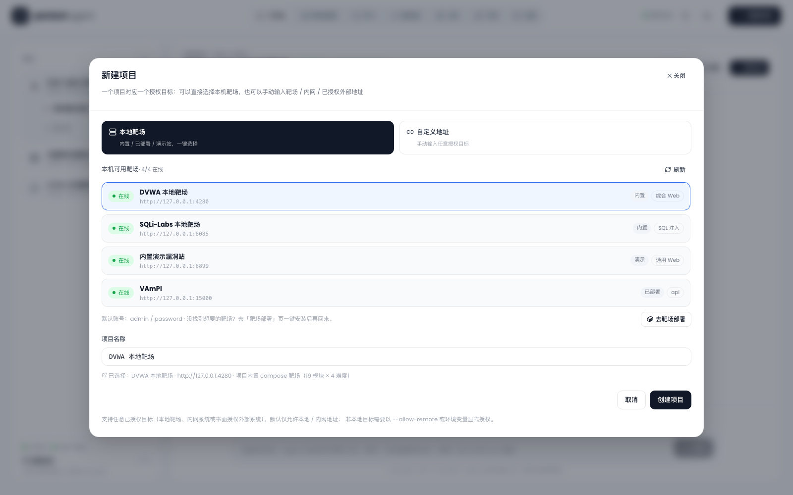

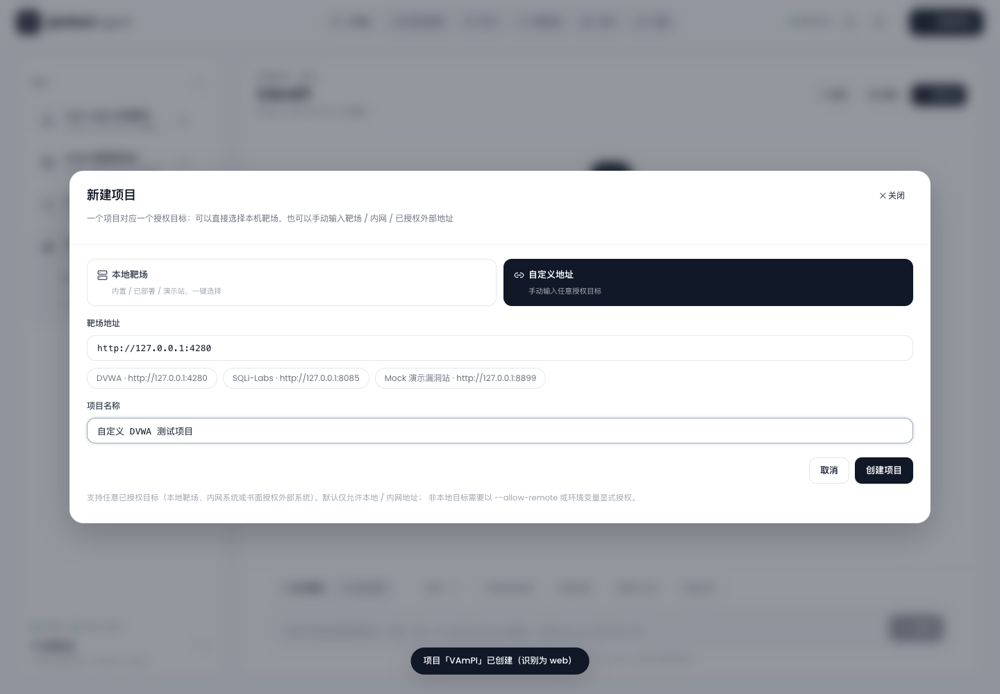

**新建对话 / 欢迎页**：

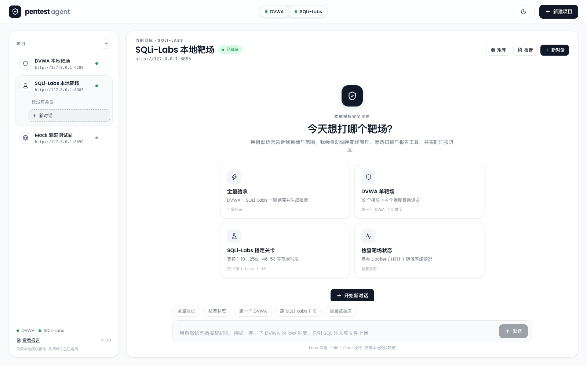

**执行中的对话（实时任务卡片 + 日志）**：

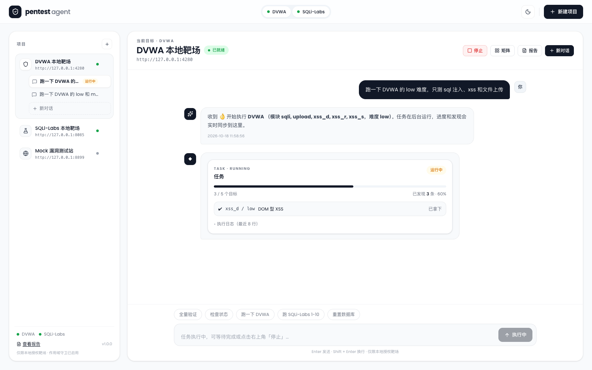

**任务完成（统计卡片 + 快捷操作）**：

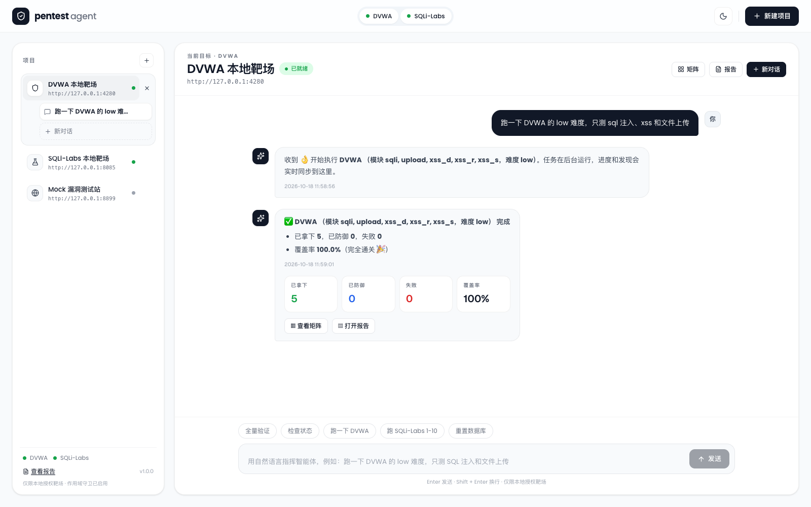

**结果矩阵（弹窗）**：

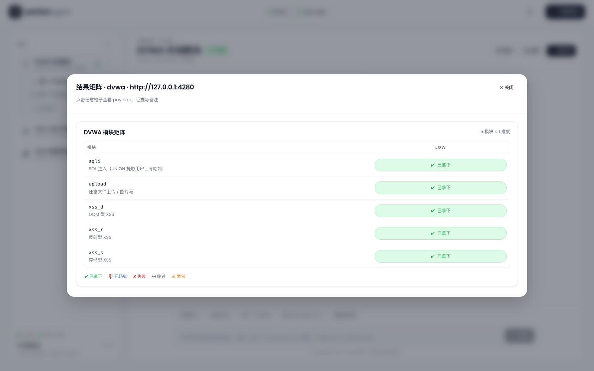

**证据抽屉（点击矩阵格子）**：

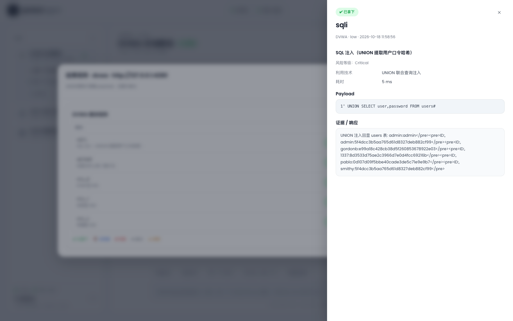

**报告弹窗**：

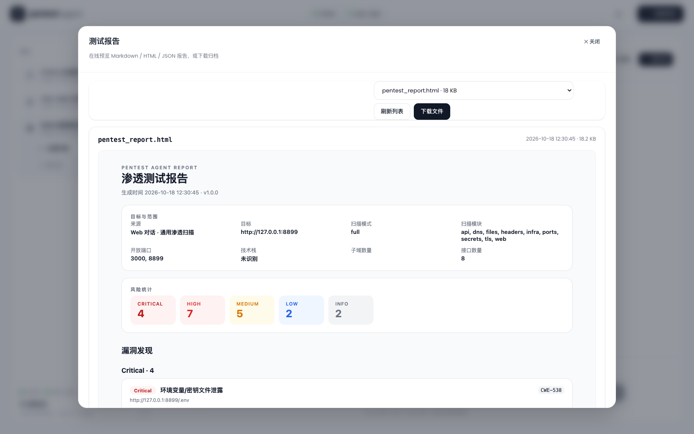

**新建项目**：

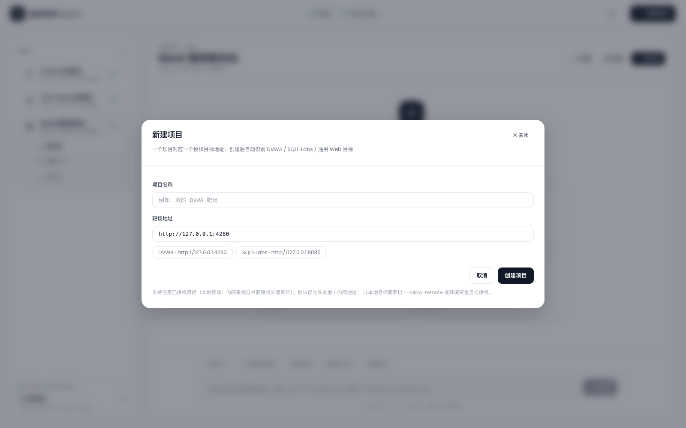

**深色模式（跟随系统 / 顶部按钮切换，持久化到本地）**：

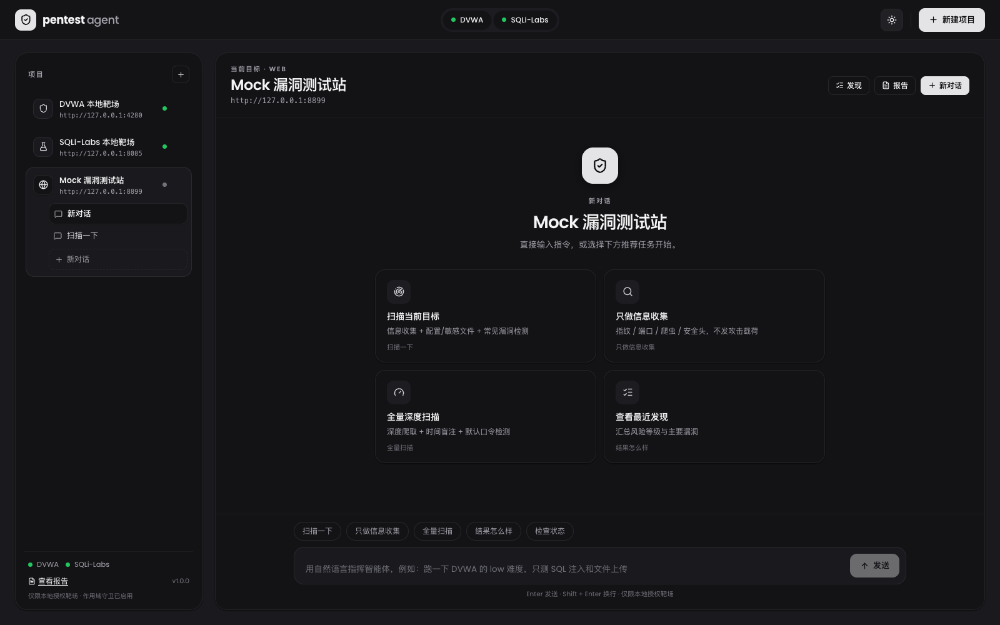

### 5.2 自然语言用法

直接像和助手聊天一样下指令：

| 指令示例 | 效果 |
|---|---|
| `跑一下 DVWA` | DVWA 全部模块 × 全部难度 |
| `跑一下 DVWA 的 low 和 medium 难度，只测 sql 注入、xss、文件上传和命令注入` | 自动解析模块、难度并按范围执行 |
| `跑 SQLi-Labs 1-10，再跑 25a` | 自动解析关卡范围并执行 |
| `全量验证` | 依次跑 DVWA + SQLi-Labs，合并生成报告 |
| `检查状态` / `启动靶场` / `停止靶场` / `重置数据库` | 靶场生命周期管理 |
| `结果怎么样` / `看看矩阵` / `打开报告` | 查看结果与报告 |
| `/help` `/status` `/dvwa` `/sqli` `/verify` `/report` `/reset` | 斜杠快捷指令 |

Agent 支持识别中英文、模块中文名、难度（low/medium/high/impossible、低/中/高/不可能）、关卡范围（`1-10`、`25a`、`46-53`）以及目标地址。**配置大模型后**这些指令由模型理解并转成 function calling（支持任意自然语言表述，见 [5.3](#53-codex--claude-式-agent-对话执行模式--大模型驱动)）；**未配置时**退回规则关键词引擎，无法识别会返回使用帮助。

### 5.3 Codex / Claude 式 Agent 对话（执行模式 · 大模型驱动）

配置好 AI 模型后，执行模式不再返回固定话术，而是像 Codex / Claude Code / DSH 一样完成
**思考 → 调工具 → 观察结果 → 继续下一步 → 总结** 的完整 Agent 循环：

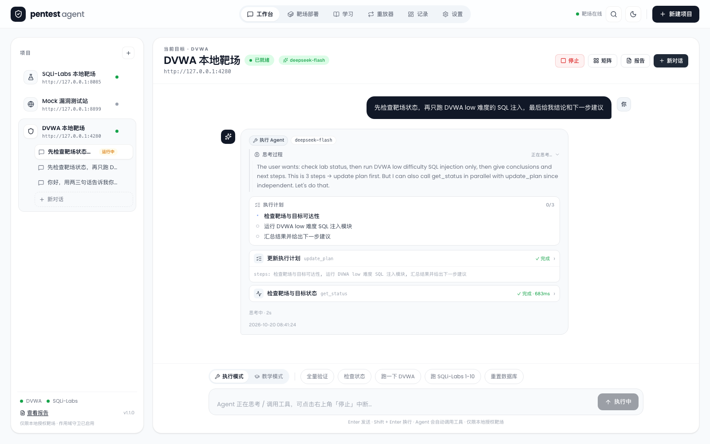

- **流式思考 + 流式正文**：消息气泡内先出现可折叠的「思考过程」（模型 `reasoning_content` 流式累积，回答结束后自动收起），正文逐字渲染，底部实时显示「正在输出 / 思考中 · Ns」；
- **工具调用卡片**：模型每次 function call 都渲染成一张卡片 —— 工具中文名、参数摘要、运行中 / 完成 / 失败、耗时，可展开查看完整输出；扫描类工具还附「查看发现 / 查看矩阵 / 打开报告」按钮，工具执行期间的实时进度仍以任务卡片回显；
- **执行计划清单**：多步任务先调用 `update_plan`，对话里渲染成待办清单，回答完成后自动勾选；
- **14 个本地工具**：`get_status` / `run_web_scan`（recon · quick · full，可筛模块）/ `run_dvwa`（难度 × 模块）/ `run_sqli_labs`（关卡列表）/ `verify_all` / `lab_control`（启动 · 停止 · 重置）/ `get_results` / `get_report` / `list_deployable_labs` / `deploy_lab` / `set_target` / `get_current_context` / `update_plan`，全部复用平台既有的作用域守卫、运行记录与报告生成逻辑；
- **多步工具编排**：单轮回答最多 6 步，工具结果以 `role=tool` 回灌模型，由模型决定继续调工具还是给出结论（例如「先检查状态 → 再跑 DVWA low 的 SQL 注入 → 再读结果 → 总结」）；
- **随时停止**：流式生成可立即中断；工具执行中停止会取消当前运行，且不再继续追问模型；
- **离线兜底**：未配置模型时执行模式自动退回规则引擎；斜杠命令（`/help` `/status` `/dvwa` `/sqli` `/verify` `/report` `/reset`）始终走确定性快捷路径；
- **会话可回放**：思考过程、工具卡片、计划清单都持久化在 `web_data/chat.json`，重新打开会话仍能看到完整执行轨迹。

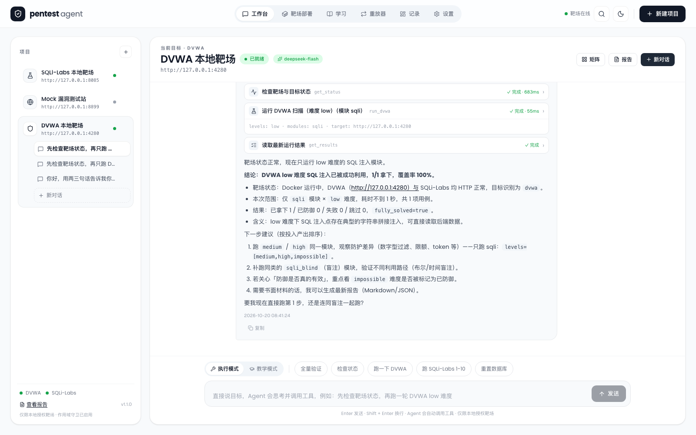

点开任意工具卡片可以查看完整输出（思考过程、参数、输出、耗时都可回看）：

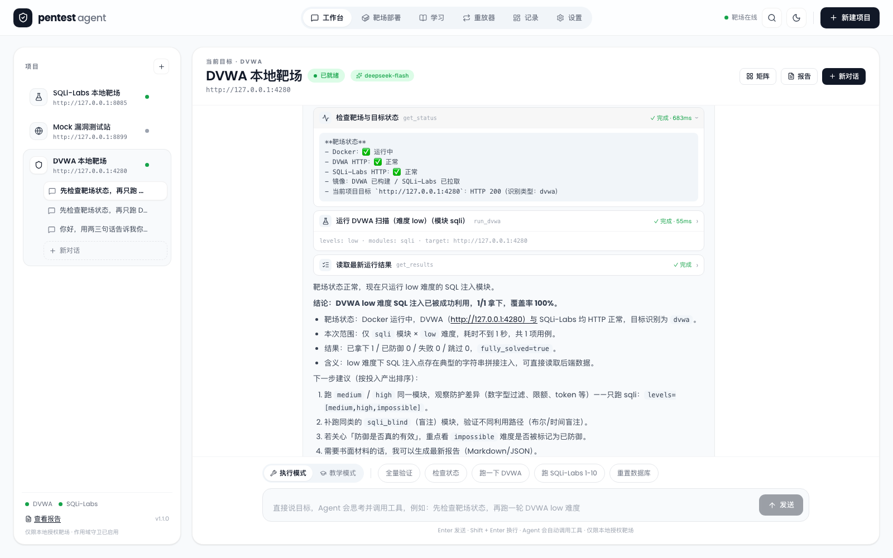

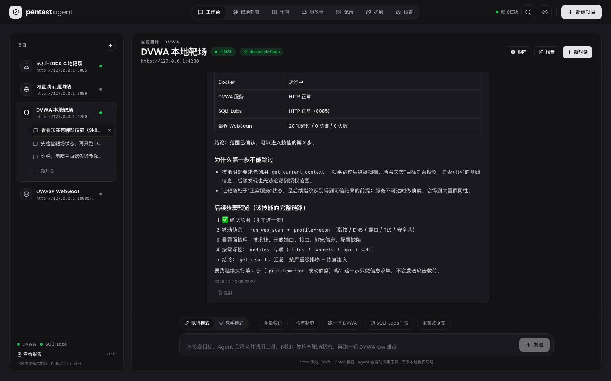

### 5.4 AI 教学模式（靶场导师）

执行模式负责「自动跑靶场」，**教学模式**负责「卡住时答疑」。把输入框上方的开关切到「教学模式」，就可以像问实验课助教一样提问：

| 场景 | 可以直接这样问 |
|---|---|
| 不会做某关 | `Less-5 我判断不出闭合方式，先给我提示，不要直接给答案` |
| 想懂原理 | `讲讲 SQL 注入里字符型和数字型的区别，以及怎么判断` |
| payload 不通 | `我的 UNION 一直报错，把可能原因和排查顺序列给我` |
| 要完整解法 | `直接给我完整步骤和 payload，并逐行解释为什么这样构造` |

教学模式下：

- **提示优先、不剧透**：默认只给思路、判断方法和下一步验证动作；只有明确说「给我答案 / 完整步骤」才会给完整解法，并逐行解释；
- **先排错再给招**：贴报错、无回显、返回不正常时，会先列出可能原因和对应验证方法；
- **自动带入靶场上下文**：当前项目是 DVWA 还是 SQLi-Labs、多少关、可选难度、靶场地址等会一并提供给模型，回答不会泛泛而谈；
- **自动读取当前关卡**：学生提到某个 DVWA 模块 / SQLi-Labs 关卡（或在聊天头部点「读取关卡」选择）时，平台会真实登录靶场、抓取当前页面回显 + 关卡源码注入上下文，不需要手动复制粘贴；
- **分层提示**：回复下方的「提示①②③ / 给答案 / 我懂了」由平台约束提示强度（方向 → 方法 → 关键结构 → 完整答案），并把看过的最高提示层级、导师对话次数、掌握状态自动记入学习档案；
- **流式回复**：答案边生成边显示，可随时点「停止」中断；密钥只保存在本机，界面仅显示掩码；
- **与执行模式统一体验**：同样有「思考过程」折叠块、工具调用卡片（`fetch_lab_context` 读取真实页面 / `get_knowledge_card` 读取知识卡 / `get_learning_progress` 读取进度）和模型徽章。

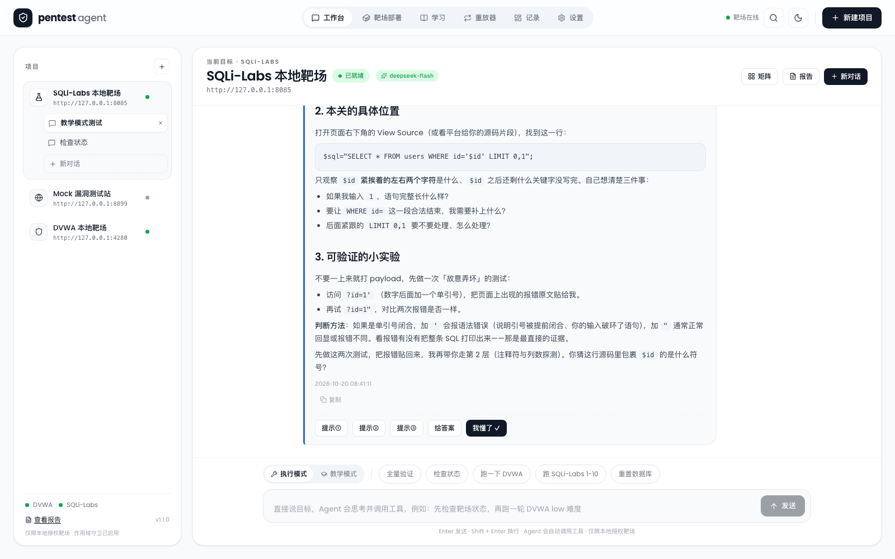

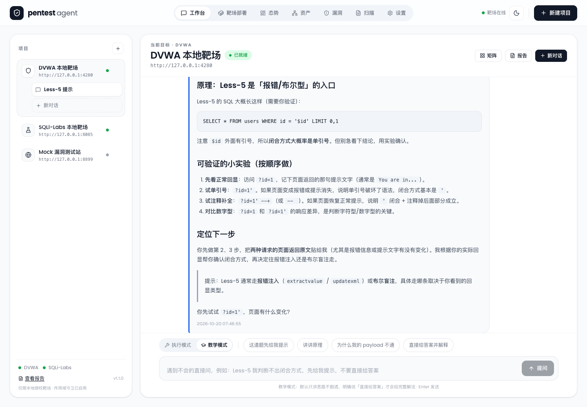

**一次性配置**：顶部「设置 → AI 教学模型」，填写 Base URL / 模型名称 / API Key，保存后点「测试连接」；也可以点 **「探测可用模型」** 自动查询该 Base URL 下的模型列表并一键填入（例如 DeepSeek 当前可用 `deepseek-flash` / `deepseek-v4-pro`）。支持任何 OpenAI Chat Completions 兼容服务：

| 服务 | Base URL | 模型示例 | 说明 |
|---|---|---|---|
| DeepSeek（推荐） | `https://api.deepseek.com` | `deepseek-flash`（快速）/ `deepseek-v4-pro`（更强推理） | 需在 platform.deepseek.com 申请 Key |
| OpenAI | `https://api.openai.com/v1` | `gpt-4o-mini` | 官方接口需要带 `/v1` |
| 本地 Ollama | `http://127.0.0.1:11434/v1` | `qwen2.5:7b` | 本地地址可不填 Key，完全离线 |
| 硅基流动 / vLLM / OneAPI 等 | 对应 `/v1` 地址 | 服务商模型名 | 只要兼容 Chat Completions 即可 |

也支持环境变量（优先级低于界面配置，适合无界面部署）：

```bash
export PENTEST_LLM_BASE_URL=https://api.deepseek.com
export PENTEST_LLM_API_KEY=sk-...
export PENTEST_LLM_MODEL=deepseek-flash
# 便捷写法：只设置 DEEPSEEK_API_KEY / OPENAI_API_KEY 也会自动识别
```

配置保存在 `web_data/llm_settings.json`（权限 `0600`），接口只返回掩码；未配置时切到教学模式会给出配置引导，执行模式不受影响。

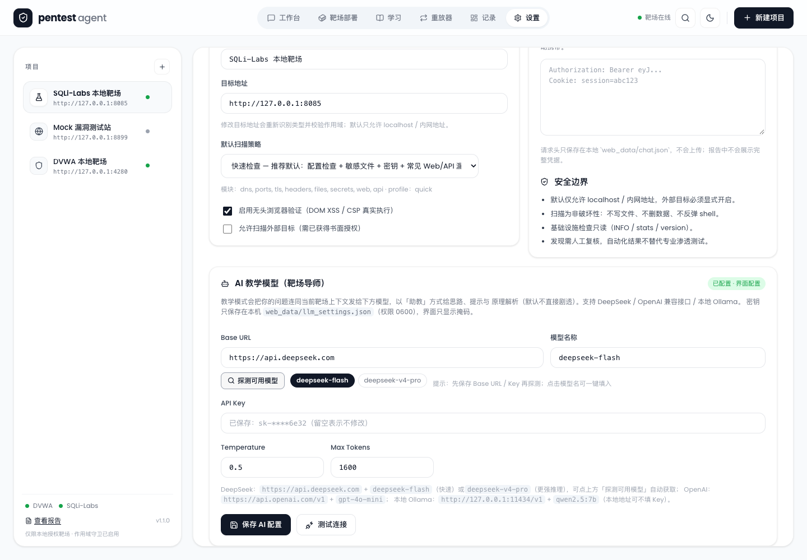


### 5.5 扩展系统（技能 Skills · MCP 服务器）

顶部导航新增「扩展」页，让平台像 Claude / Codex / DSH 一样可以「装东西」：**技能**扩展 Agent 的流程知识，**MCP** 扩展 Agent 的工具能力。配置默认只保存在本机 `web_data/`，下一轮对话立即生效。

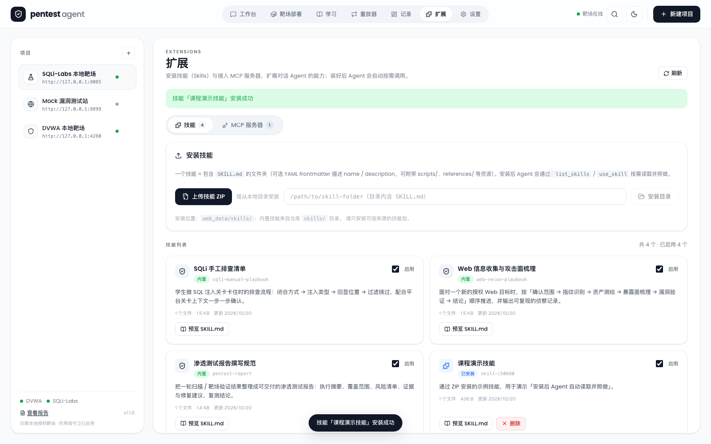

#### 技能（Skills）

- **技能包格式**：一个文件夹 + 根目录 `SKILL.md`（可选 YAML frontmatter `name` / `description`），可附带 `scripts/`、`references/` 等资源；仓库内置 3 个示例技能（Web 信息收集、SQLi 手工排查、报告撰写规范）位于 `skills/`；
- **安装方式**：上传 ZIP（自动校验路径穿越、文件数 / 体积上限，兼容「根目录带 SKILL.md」或「唯一子目录带 SKILL.md」两种打包方式），或填写本地目录路径安装；安装到 `web_data/skills/`；
- **管理**：列表 / 预览 `SKILL.md` / 启用停用 / 删除（内置技能只读）；启停状态写入 `web_data/extensions.json`；
- **Agent 自动使用**：技能名与描述会注入系统提示，模型需要时调用 `list_skills` 列出技能、`use_skill` 读取正文后严格按步骤执行（可继续调用其它工具完成技能流程）。

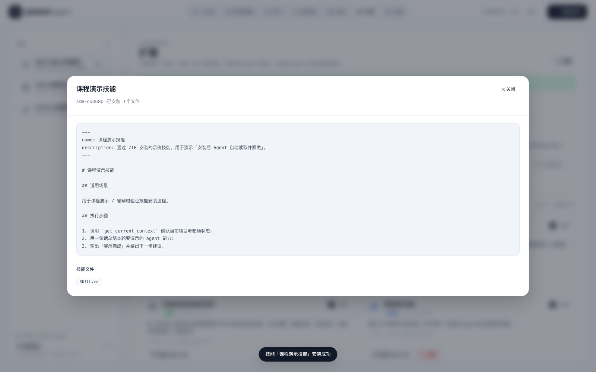

#### MCP（Model Context Protocol）

- **两种传输**：`stdio`（本地子进程：python / npx / uvx 启动的 MCP Server）与 `http`（Streamable HTTP JSON-RPC 端点，可自定义请求头）；配置保存在 `web_data/mcp_servers.json`；
- **管理界面**：新增 / 编辑 / 删除 / 启用停用服务器，一键「测试连接」返回延迟、服务端信息与工具清单；同时显示连接状态、工具数与错误原因；
- **工具自动并入 Agent**：MCP 工具以 `mcp__<服务器>__<工具>` 的名字动态注册给大模型（自动带上 JSON Schema），模型可以像本地工具一样调用；连接按需建立，某个服务器失败会自动降级、不影响普通对话；
- **内置安全工具 Server**：仓库自带 `pentest_agent/mcp_server.py`，提供 **7 个真实工具** —— `dns_lookup`（真实 DNS 解析）、`http_probe`（真实 HTTP 请求，带作用域守卫）、`port_check`（真实 TCP 连接）、`tls_certificate`（真实 TLS 握手与证书读取）、`hash_encode`（md5/sha1/sha256/base64/URL）、`jwt_decode`（真实解析 + alg=none/弱密钥检查）、`scope_check`；添加时命令填 `python3`、参数填 `-m` / `pentest_agent` / `mcp-server` 即可，界面一键填入；也内置官方 Filesystem Server 预设；
- **安全边界**：stdio 服务器会以当前用户权限执行本地命令，请只接入可信来源；HTTP 建议只连本机 / 内网地址；所有 MCP 调用都在本机进行。

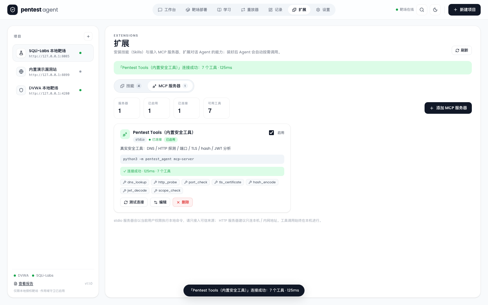

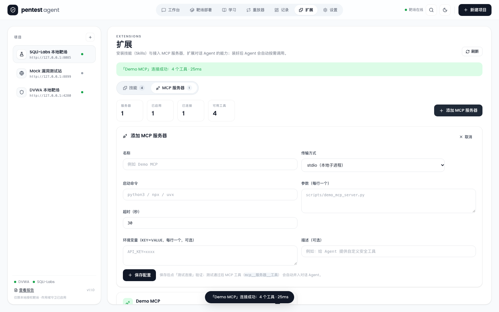

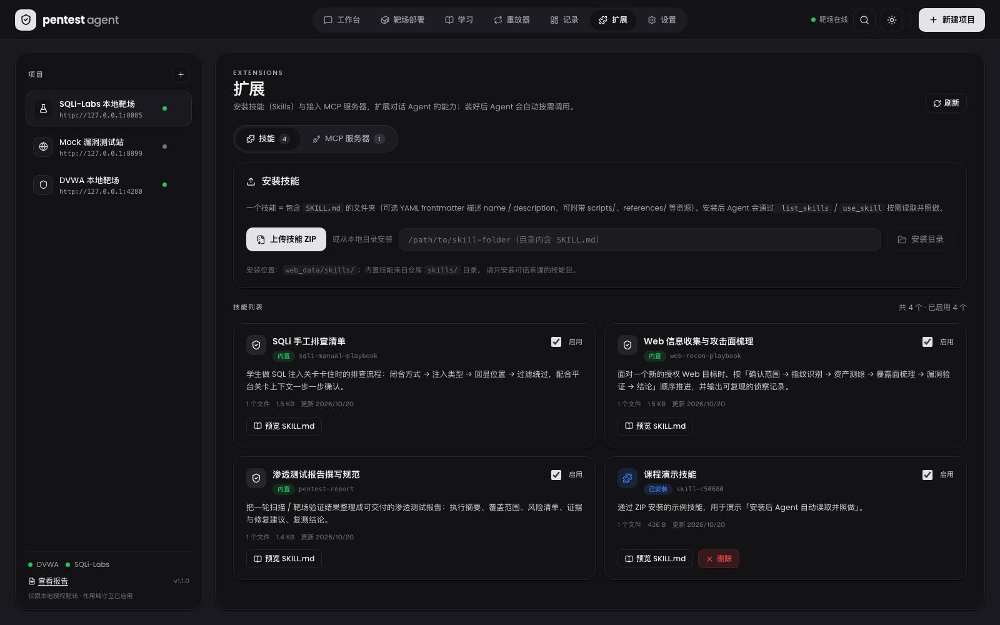

> 实测（真实 DeepSeek 模型）：对话中先 `list_skills` → `use_skill` 读取「Web 信息收集与攻击面梳理」→ 按技能第一步调用 `get_current_context`；MCP 工具由内置安全工具 Server 真实执行（`hash_encode` 计算 SHA-256、`http_probe` 真实请求本地服务、`port_check` 真实连接端口），工具卡片耗时均 < 10ms（本地 stdio）。

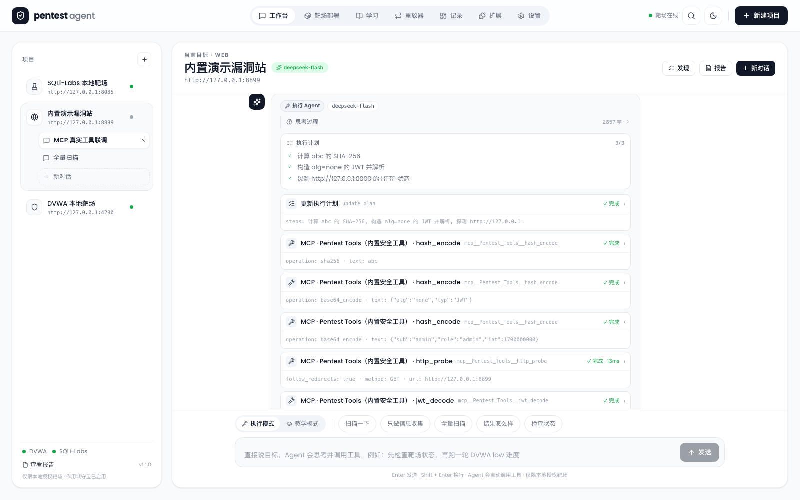

### 5.6 技术实现

- **前端**：`web/`，React 18 + TypeScript + Vite + marked；`src/components/chat/` 下为 Sidebar / ChatView / MessageItem / ToolCallCard / RunCard / Composer / 各类弹窗组件，`src/components/views/ExtensionsView.tsx` 为技能 / MCP 管理页，样式分别在 `src/agent-ui.css`（思考折叠 / 工具卡 / 计划清单 / 流式光标 / 代码复制）与 `src/extensions.css`；
- **后端**：`pentest_agent/web/` 十个模块 + `pentest_agent/knowledge/` 知识卡片：
  - `server.py`：Flask REST API + SSE；
  - `runs.py`：扫描 / 靶场任务管理与历史；
  - `chat.py`：项目 / 会话 / 消息存储与事件流；
  - `llm_agent.py`：**LLM Agent 循环**（流式 reasoning / function calling / 多步工具编排 / 思考与工具事件），执行模式与教学模式共用；
  - `extensions.py`：**扩展系统**（技能扫描 / ZIP 安装 / 启停 / 预览 + MCP stdio/HTTP 客户端、连接管理与工具动态注册）；
  - `mcp_server.py`：**内置安全工具 MCP Server**（DNS / HTTP 探测 / 端口 / TLS / hash / JWT / 作用域检查，真实实现）；
  - `labs/demo_webapp.py`：**内置演示靶场**（真实 SQLite / SQLi / 命令执行 / LFI / SSTI / SSRF / JWT alg=none，不是 mock）；
  - `agent.py`：对话式 Agent 工具层（意图解析 + 扫描 / 靶场 / 报告 / 部署等工具实现，供 LLM Agent 循环调用）；
  - `tutor.py`：AI 教学模型配置与教学 Prompt（OpenAI 兼容 LLM 客户端、靶场上下文、配置读写）；
  - `deploy.py`：靶场部署中心（靶场目录、Docker 拉取/运行/启停、端口分配、健康检查、状态复用）；
  - `learning.py`：学习进度 / 错题本存储（状态、提示层级、笔记、从历史解题结果回填）；
  - `lab_context.py`：关卡上下文采集（DVWA 登录 + 页面 + 源码、SQLi-Labs 关卡 + 源码、四难度源码 diff）；
  - `repeater.py`：请求重放器（作用域守卫 + 任意方法重放 + 响应截断）；
  - `quiz.py`：AI 出题 / 判题（知识卡片 + 源码上下文 → JSON 题目 / 逐题评分）；
  - `knowledge/`：19 张 DVWA 模块卡 + 13 组 SQLi-Labs 知识卡（原理 / CWE / OWASP / 关键思路 / 防御）；
- **实时链路**：Agent 线程 → 会话事件流（`message` / `delta` / `reasoning` / `run` / `run_log` / `turn`）→ `GET /api/conversations/{id}/stream`（SSE）→ 前端增量渲染（思考折叠 / 工具卡片 / 流式光标）；
- **数据持久化**：项目与会话保存在 `web_data/chat.json`，任务历史在 `web_runs/`，AI 教学模型配置在 `web_data/llm_settings.json`，靶场部署记录在 `web_data/labs_deploy.json`，学习进度 / 笔记 / 复习计划 / 出题成绩在 `web_data/learning.json`，学习报告写入 `reports/learning_report_*.md`；对话触发的扫描会自动生成 Markdown / JSON 报告到 `reports/`；
- **安全**：默认只监听 `127.0.0.1`；新建项目与切换目标都会经过作用域守卫；Agent 回复与报告在渲染前转义原始 HTML，避免靶场回显被执行。

### 5.7 前端开发模式

```bash
cd web
npm install          # 首次安装依赖
npm run dev          # http://127.0.0.1:5173 ，/api 自动代理到 8777
npm run build        # 生产构建到 web/dist，再由 python -m pentest_agent web 托管
```

### 5.8 主要 API

| 方法 | 路径 | 说明 |
|---|---|---|
| GET | `/api/system` | 版本、靶场地址、HTTP 状态、AI 模型配置状态与模型名 |
| GET | `/api/projects` | 项目列表（含会话与靶场状态） |
| POST | `/api/projects` | 新建项目 `{name,target}`（自动识别靶场类型） |
| PATCH/DELETE | `/api/projects/{id}` | 更新 / 删除项目 |
| POST | `/api/projects/{id}/detect` | 重新识别靶场类型 |
| POST | `/api/projects/{id}/conversations` | 新建会话 |
| GET/POST | `/api/conversations/{id}` / `.../messages` | 会话详情 / 发送用户消息（`{content, mode}`，`mode=agent` 执行 Agent、`tutor` 教学模式） |
| GET | `/api/conversations/{id}/stream?after=N` | 会话 SSE 事件流：`message` / `delta`（正文增量）/ `reasoning`（思考增量）/ `run` / `run_log` / `turn` |
| POST | `/api/conversations/{id}/cancel` | 取消当前任务（执行任务 / 教学模式流式生成） |
| GET/PUT | `/api/settings/llm` | 读取 / 保存 AI 教学模型配置（密钥只返回掩码） |
| POST | `/api/settings/llm/test` | 测试大模型连通性，返回延迟与模型回复 |
| GET/PATCH | `/api/learning` / `/api/learning/{item_key}` | 学习进度快照 / 更新状态、笔记或完成复习（`review_done`） |
| POST | `/api/learning/{item_key}/quiz/generate` · `/quiz/grade` | AI 出题 / 提交判题（成绩写入学习档案） |
| GET | `/api/learning/report?ai=1` | 导出 Markdown 学习报告（可选 AI 教练建议） |
| GET | `/api/lab/knowledge?item_key=` | 查询关卡知识卡片（原理 / CWE / OWASP / 防御） |
| GET | `/api/labs/local` | 本机靶场源（内置 / 已部署 / 演示站 + 在线状态），供新建项目选择 |
| POST/GET | `/api/lab/context` / `/api/lab/source` | 采集关卡真实页面 + 源码 / 四难度源码对照 |
| POST | `/api/repeater/send` | 请求重放（作用域守卫 + 原始响应） |
| GET/POST | `/api/deploy/disk` / `/api/deploy/prune` | 靶场镜像磁盘占用 / 清理未使用镜像 |
| GET | `/api/deploy/catalog` | 靶场部署目录 + Docker 状态 + 每个靶场的运行状态/任务进度 |
| POST | `/api/deploy/{key}/{action}` | 部署 / 启动 / 停止 / 删除靶场（action：`install` / `start` / `stop` / `remove`） |
| GET | `/api/deploy/{key}/status` | 单个靶场的状态、端口、健康检查结果 |
| GET | `/api/deploy/{key}/logs` | 部署任务日志 + 容器日志（`docker logs`） |
| POST | `/api/runs` | 直接创建扫描任务（供程序化调用） |
| GET | `/api/runs/{id}` | 任务详情（findings / logs / summary） |
| GET | `/api/reports` / `/api/reports/{name}` | 报告列表 / 报告内容 |
| GET | `/api/results/latest` | 最新一次全量验证结果 JSON |

### 5.9 视觉设计（参考 TREK）

界面视觉参考 [TREK](https://github.com/liketrek/TREK) 的设计系统，落地为可主题化的设计令牌（`web/src/styles.css`）：

| 维度 | 设计 |
|---|---|
| 主色 | 浅色模式近黑 `#111827`（按钮/强调），深色模式浅色 `#e4e4e7`；状态色沿用 success/danger/warning/info |
| 表面 | `--bg-primary/secondary/card/tertiary` + `--border-faint`，页面浅灰底 + 白色圆角卡片 |
| 字体 | 界面 Poppins（400–700），数字/辅助 Geist Sans，代码等宽字体；小标题使用大写 + 字距的 eyebrow 样式 |
| 形状 | 卡片圆角 20px、按钮/胶囊 999px、输入框 12–16px；阴影柔和（`--shadow-card/elevated/modal`） |
| 顶栏 | 悬浮玻璃效果（`backdrop-filter: blur(20px) saturate(180%)`），中间为靶场状态胶囊 |
| 动效 | 统一 `cubic-bezier(0.23, 1, 0.32, 1)` 缓动，150–240ms；主题切换带颜色过渡 |
| 双主题 | light / dark 两套令牌；首屏 inline 脚本防闪烁；跟随系统默认，顶部按钮可切换并持久化 |

所有界面组件（顶栏、侧栏、对话、任务卡片、矩阵、发现列表、报告）都使用同一套令牌，因此新增页面无需额外适配即可自动跟随主题。

### 5.10 靶场部署中心（一键安装常见靶场）

顶部「靶场部署」页把常见公开靶场做成了一个应用市场：点击卡片上的「一键部署」，平台自动完成 `docker pull` → `docker run` → 等待就绪，全程日志实时回传；部署完成后可以直接打开地址，或在工作台新建项目交给 Agent 扫描。

- **内置 16 个常见靶场**：DVWA、SQLi-Labs（项目自带 compose 栈）、OWASP Juice Shop、WebGoat、Mutillidae II、bWAPP、Pikachu、Upload-Labs、PyGoat、DVGA（GraphQL）、VAmPI（API）、Metasploitable 2，以及 MongoDB / Redis / Memcached / Elasticsearch 未授权访问练习环境；
- **状态自动识别**：自动发现本机已有容器（例如历史部署的 `pentest-lab-*`），显示「运行中 / 已停止 / 未部署」与 HTTP 健康检查结果，不会重复拉起；
- **端口安全**：容器只监听 `127.0.0.1`（不暴露局域网）；默认端口被占用时自动顺延，部署记录写入 `web_data/labs_deploy.json`，重启后 URL 保持稳定；
- **可运维**：一键启动 / 停止 / 删除；可展开查看部署任务日志与 `docker logs` 容器输出；Apple Silicon 上自动为仅 amd64 的镜像追加 `--platform linux/amd64`（Rosetta 模拟）；
- **对话也能装**：执行模式下直接说「部署 Juice Shop」「帮我装个 WebGoat」，Agent 会创建同一套部署任务，并把实时进度、访问地址和账号回传到对话里；
- **易扩展**：新增靶场只需在 `pentest_agent/web/deploy.py` 的 `LAB_CATALOG` 里加一条（镜像、容器端口、健康检查路径、分类、说明、默认端口），前端自动渲染。

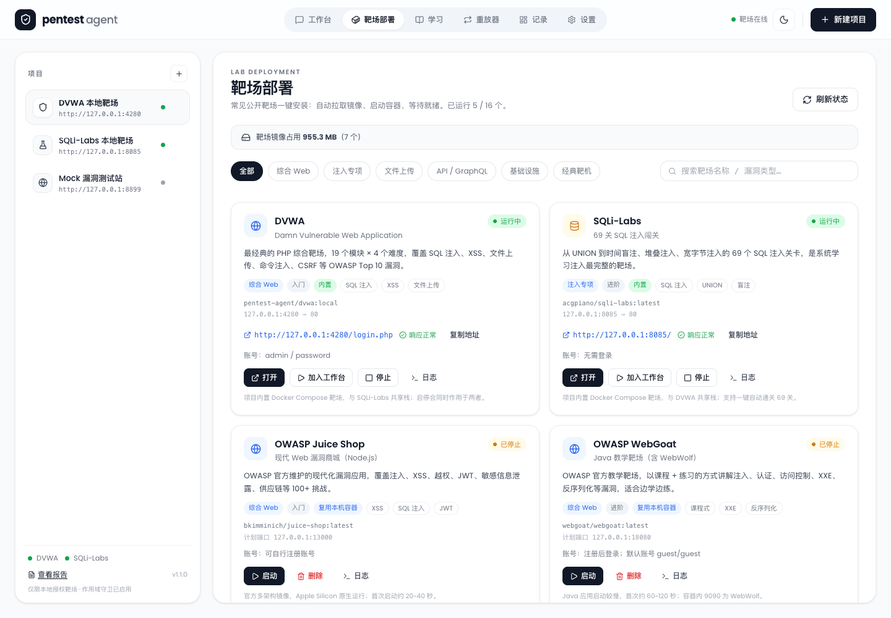

### 5.11 完整学习闭环（学 → 练 → 复习 → 报告）

「学习」页把 145 个关卡（DVWA 76 + SQLi-Labs 69）做成了可追踪的学习档案，形成完整闭环：

- **① 学（进度 + 知识卡片 + 导师）**：
  - 进度矩阵：DVWA 模块 × 难度 4×19、SQLi-Labs 69 格；状态分「未开始 / 在学 / 已掌握 / 待复习」，绿点表示历史自动解题已验证（只代表参考答案跑通，不代表掌握）；
  - 错题本：每关可写笔记，支持「只看有笔记」筛选；
  - 源码对照：DVWA 四难度源码一键切换 + low→medium→high→impossible diff；
  - **知识卡片**：19 个 DVWA 模块 + 13 组 SQLi-Labs 卡片，含原理 / CWE / OWASP / 关键思路 / 防御，学习弹窗内直接看，也会自动注入 AI 导师上下文；
  - **一键问导师**：「读取当前页面再给提示」会把真实页面回显 + 源码 + 知识卡片注入教学模式，只给第 1 层提示。
- **② 练（AI 出题 + 判题）**：基于知识卡片与关卡源码生成 3 道由易到难的简答题（不给答案、只给提示），提交后逐题点评 + 总分 + 改进建议；≥80 分自动标记已掌握，成绩写入学习档案（最高分出现在进度矩阵里）。
- **③ 复习（间隔遗忘曲线）**：标记已掌握后 3 天首次提醒，标记待复习后 1 天提醒；完成一次复习后间隔递增 3 → 7 → 14 → 30 天。学习页顶部显示「今日到期」提醒和「连续学习 N 天」。
- **④ 报告（复盘 + AI 建议）**：一键导出 Markdown 学习报告（总进度、DVWA 矩阵、SQLi 分组、错题笔记、AI 练习记录、最近动态、下一步建议），可选让已配置的大模型根据你的学习数据写 5 条具体建议；报告保存到 `reports/learning_report_*.md`。

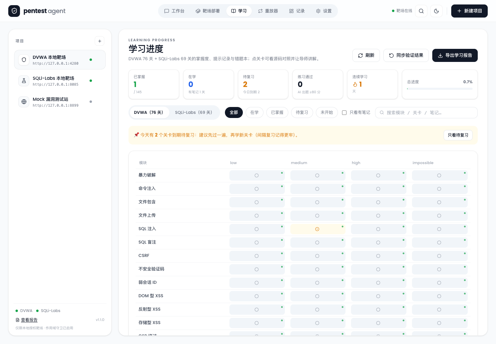

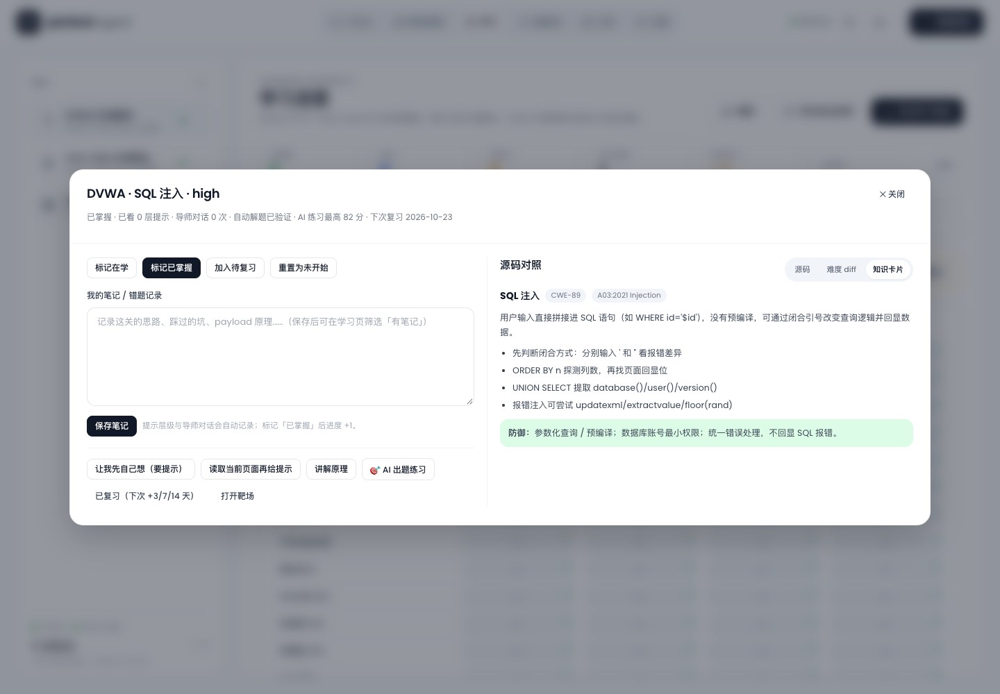

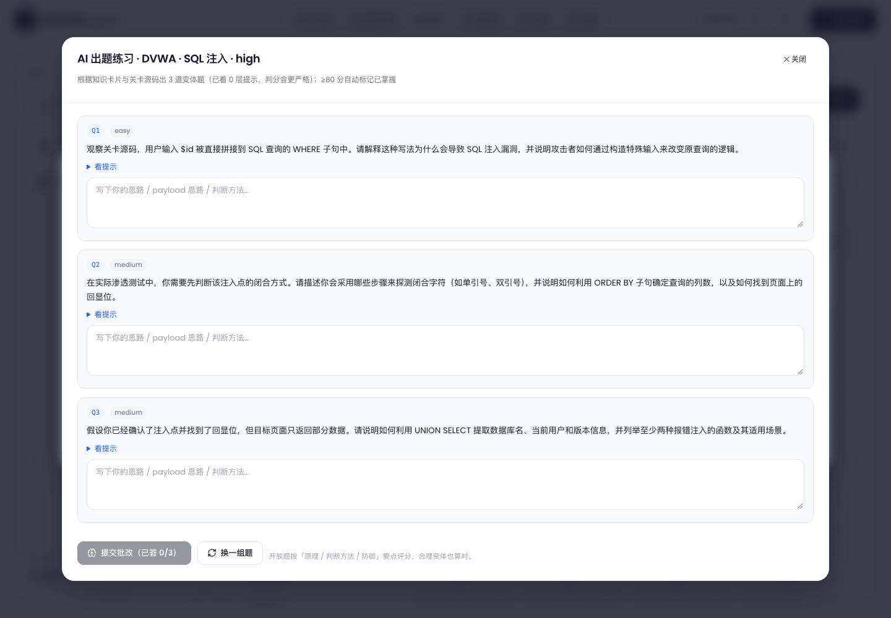

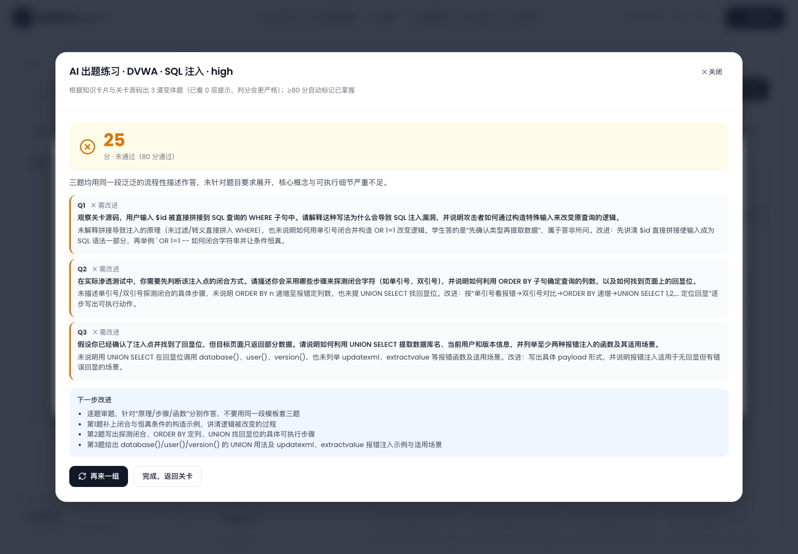

**⌘K 全局命令面板**：任意页面按 ⌘K / Ctrl+K，搜索页面、145 个关卡、16 个靶场，回车直达（关卡会直接打开详情弹窗）。

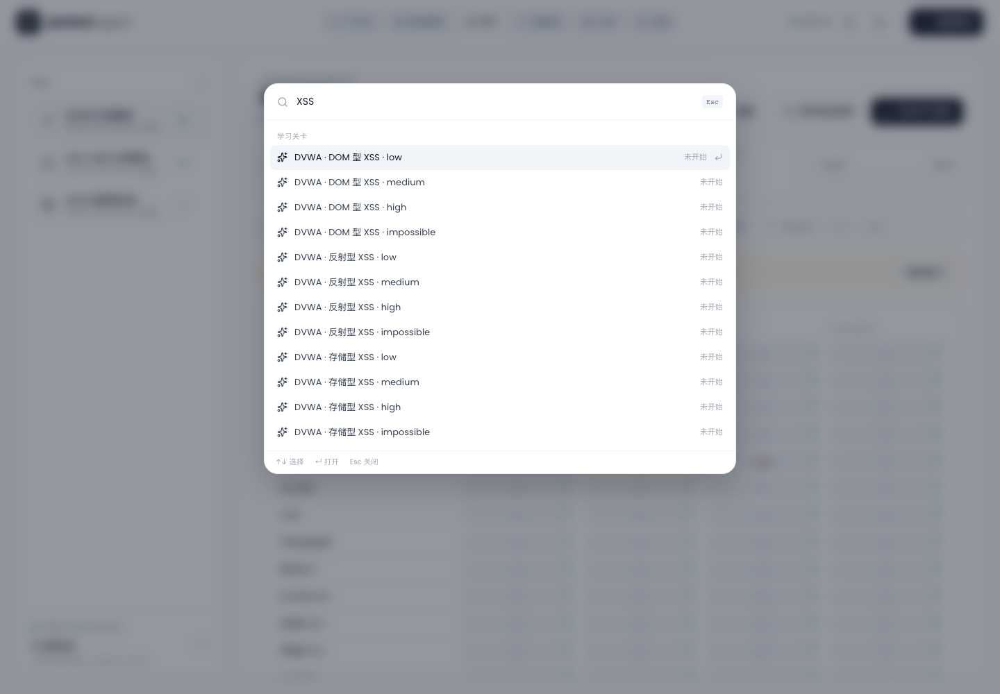

**请求重放器**（顶部「重放器」）用于手工验证：改 method / URL / headers / body → 发送 → 查看原始响应、响应头或沙箱渲染结果；内置 DVWA / SQLi-Labs / 演示漏洞站快捷预设，历史记录保存在浏览器本地。

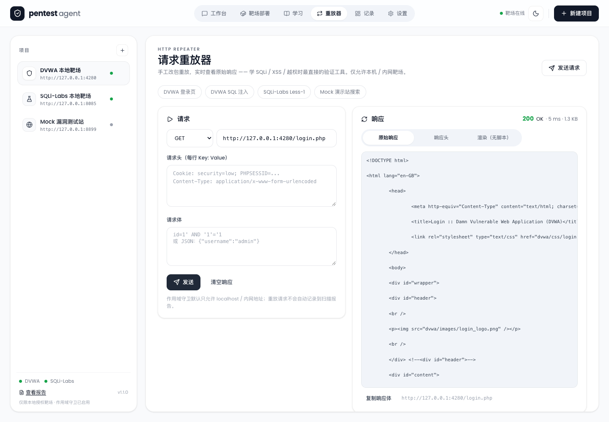

教学对话中的分层提示与关卡标记：

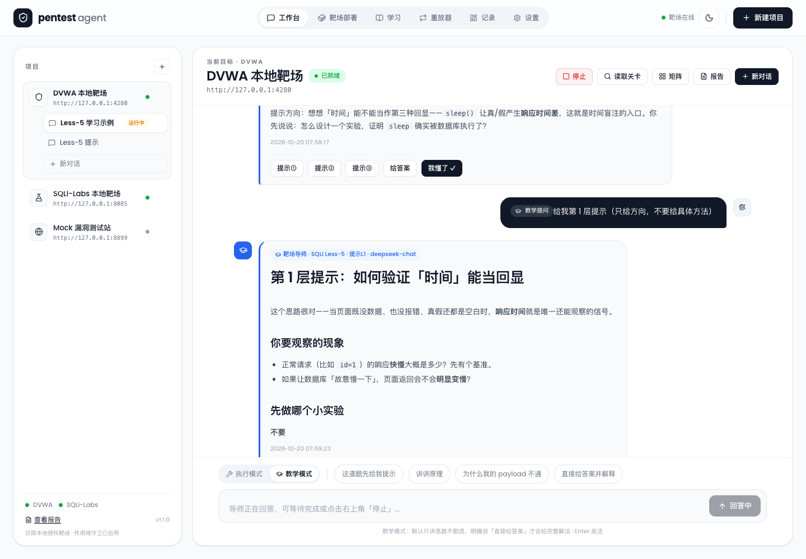

## 6. 安全测试平台（资产 · 漏洞 · 扫描 · 策略）

`python -m pentest_agent web` 不只是对话界面，而是一套完整的安全测试工作台：**对话负责执行，平台负责管理**。扫描完成后，结果自动写入 SQLite 资产台账与漏洞库，可在顶部「记录」页的四个 Tab（安全态势 / 资产 / 漏洞 / 扫描）中持续跟踪。

### 6.1 安全态势（Dashboard）

- 关键指标：风险总数、待处理、资产数、扫描次数
- 风险等级分布（严重 / 高危 / 中危 / 低危 / 信息）与堆叠风险条
- 漏洞分类 TOP 8、OWASP Top 10 (2021) 分布
- 最近扫描列表，一键回看结果
- 支持「全部项目 / 当前项目」范围切换

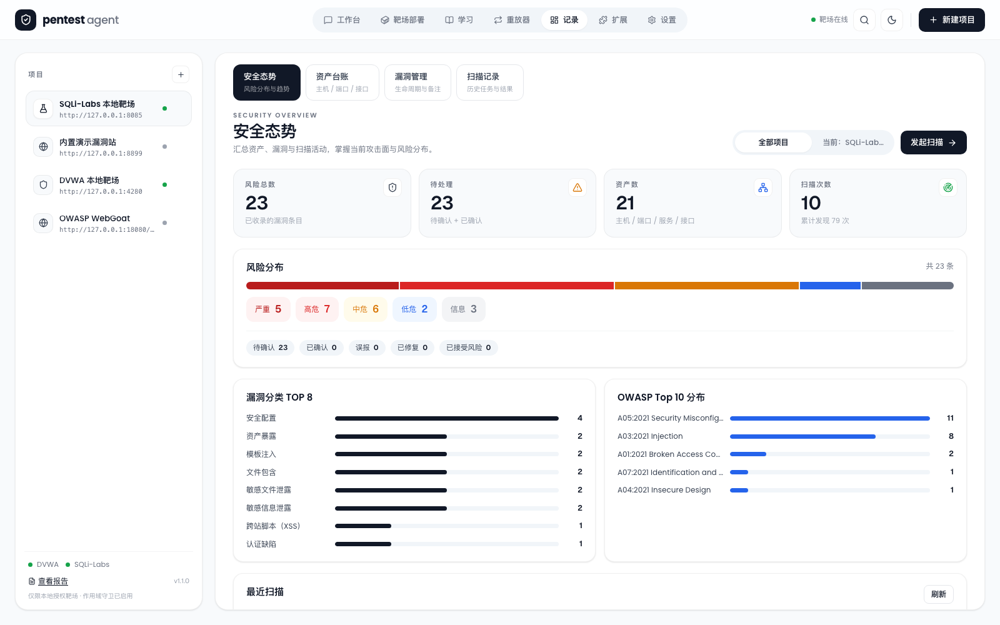

### 6.2 资产台账（Assets）

- 扫描过程中自动沉淀：主机、端口、服务、子域、技术栈、接口
- 类型筛选（主机/端口/服务/子域/接口/技术栈）+ 关键词搜索
- 展示首次/最近发现时间与命中次数，便于资产测绘与暴露面梳理

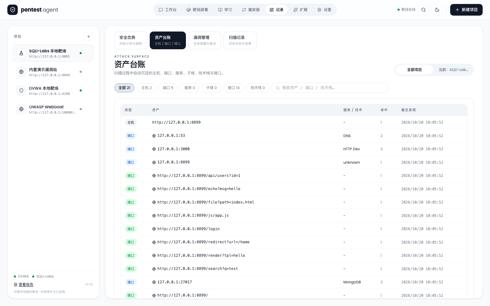

### 6.3 漏洞管理（Vulnerabilities）

- **自动去重**：按「标题 + 目标 + CWE」指纹合并，重复发现只更新最近时间
- **生命周期状态**：待确认 → 已确认 / 误报 / 已修复 / 已接受风险，可填写处理备注
- 详情包含 CWE、OWASP、payload、证据、修复建议与首次/最近发现时间
- 按严重等级、状态筛选与关键词搜索

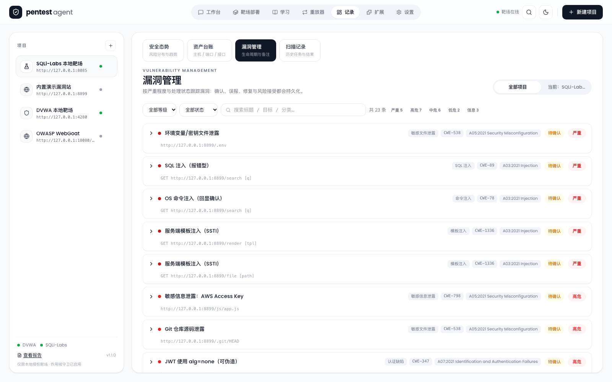

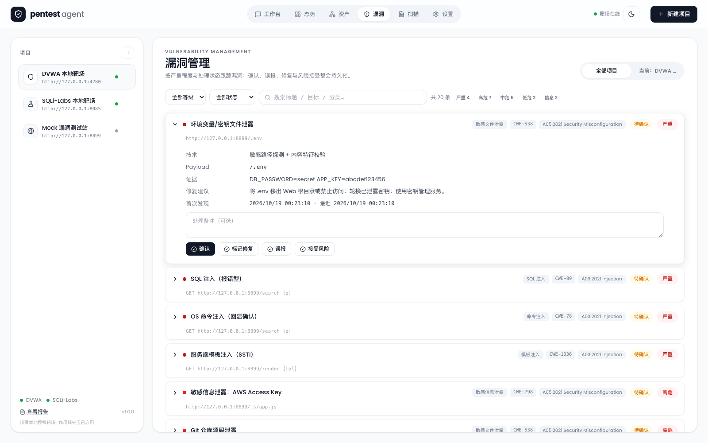

### 6.4 扫描记录（Scans）

- 记录所有任务：通用扫描、DVWA / SQLi-Labs 靶场任务
- 状态、扫描模式、风险分布（C/H/M/L/I）一目了然
- 点击「结果」直接打开发现列表或结果矩阵

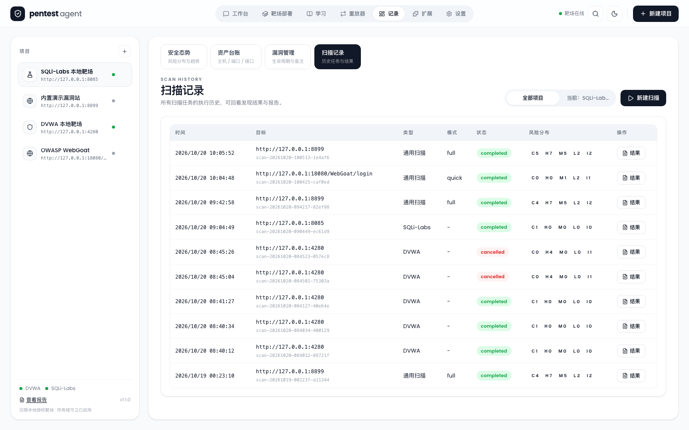

### 6.5 项目设置与扫描策略（Settings）

- **6 种内置扫描策略**：资产测绘、快速检查、全量深测、API 专项、基础设施、暴露面检查
- **认证扫描**：按项目配置 `Authorization` / `Cookie` 等请求头，扫描器自动携带
- 无头浏览器验证开关、外部目标授权开关（默认禁止）
- 保存后下一次扫描生效；所有配置仅保存在本地

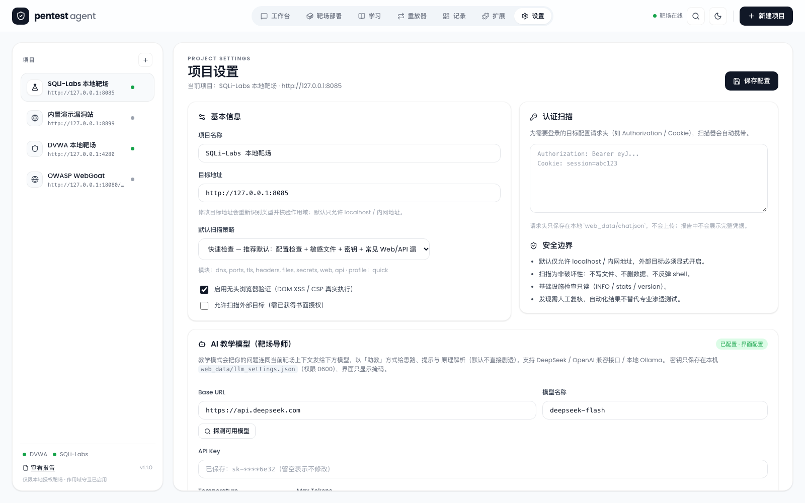

### 6.6 数据与平台 API

| 数据 | 位置 |
|---|---|
| 项目 / 会话 / 配置 | `web_data/chat.json` |
| 资产 / 漏洞 / 扫描历史 | `web_data/security.db`（SQLite，WAL） |
| 扫描任务事件 | `web_runs/<run_id>.json` |
| 报告 | `reports/`（Markdown / HTML / JSON） |

| 方法 | 路径 | 说明 |
|---|---|---|
| GET | `/api/dashboard` | 风险统计、分类/OWASP 分布、最近扫描 |
| GET | `/api/assets` | 资产台账（可按 `kind` 过滤） |
| GET | `/api/vulnerabilities` | 漏洞列表（status/severity/search 过滤） |
| PATCH | `/api/vulnerabilities/{id}` | 更新漏洞状态 / 备注 |
| GET | `/api/scans` | 扫描历史 |
| GET | `/api/policies` | 内置扫描策略 |
| PATCH | `/api/projects/{id}` | 更新项目策略 / 认证头 / 授权开关 |

### 6.7 一键启动

```bash
# 启动平台（自动创建虚拟环境、构建前端）
./scripts/start.sh

# 同时启动演示漏洞站（http://127.0.0.1:8899）用于体验
./scripts/start.sh --with-demo

# 同时拉起 DVWA / SQLi-Labs 靶场
./scripts/start.sh --with-labs --with-demo
```

打开 http://127.0.0.1:8777 ，在顶部导航切换「工作台 / 态势 / 资产 / 漏洞 / 扫描 / 设置」。

## 7. 通用 Web 渗透测试（任意授权目标）

除内置靶场解题外，Agent 提供通用 Web 渗透引擎（`pentest_agent/engines/webscan.py` + `webinject.py`），可对任意**已获授权**的目标执行「信息收集 → 配置/敏感文件检查 → 主动漏洞探测 → 证据报告」。

### 7.1 能力范围（网安全链路）

| 阶段 | 能力 |
|---|---|
| 资产测绘 | HTTP 指纹、技术栈识别、DNS 记录（A/AAAA/CNAME/MX/NS/TXT）、子域字典枚举、子域接管启发式、端口与服务指纹、JS 接口提取、爬虫（链接/表单/参数）、robots.txt、TLS 证书 |
| 网络基础设施 | TCP 连接扫描（含目标自身端口）、SSH/MySQL/SMTP/FTP/MongoDB banner、FTP 匿名登录、Redis `INFO`、Memcached `stats`、Docker Remote API、Elasticsearch、Kibana、Prometheus、RabbitMQ 默认口令等**未授权访问**检查 |
| Web 漏洞 | SQL 注入（报错/布尔/时间盲注 + 版本提取）、反射型 XSS（可选浏览器确认）、SSTI 模板注入、SSRF（本地 canary 带外确认）、LFI/路径穿越、OS 命令注入（回显/时间）、开放重定向、CRLF 响应头注入、Host 头注入、POST 表单 CSRF Token 缺失 |
| API / 会话 | GraphQL introspection、JWT 提取与解析、`alg=none` 检测、HS256 弱密钥字典校验、Cookie 安全属性、CORS 配置、HTTP 方法 |
| 敏感信息 | `.git`/`.env`/备份/Swagger/actuator 等 20+ 敏感路径；JS/HTML 中 AWS AK/SK、Google API Key、GitHub/Slack/Stripe Token、私钥、JWT、URL 内嵌凭据、通用口令赋值、内网 IP（证据自动脱敏） |
| 安全配置 | 缺失安全响应头（CSP/XFO/nosniff/Referrer-Policy/Permissions-Policy/HSTS）、Cookie HttpOnly/Secure/SameSite、CORS 通配、目录列表、错误堆栈泄露、版本泄露、TLS 证书过期/自签名、TLS 1.0/1.1 支持 |
| 报告与合规 | 风险等级、CWE、CVSS、OWASP Top 10 (2021) 映射、payload、请求/响应证据、修复建议；Markdown + HTML + JSON；对话内风险统计与攻击面摘要 |

**扫描模块开关**（CLI `--modules` / 对话自然语言选择）：

| 模块 | 说明 |
|---|---|
| `dns` | DNS 记录、子域枚举、子域接管 |
| `ports` | 端口扫描、服务指纹 |
| `tls` | 证书有效期、TLS 1.0/1.1 支持 |
| `infra` | Redis / Docker / ES / Kibana / Memcached / RabbitMQ / FTP 等未授权访问 |
| `headers` | 安全响应头、Cookie、CORS、HTTP 方法 |
| `files` | 敏感文件、备份、源码泄露 |
| `secrets` | JS/HTML 密钥与敏感信息扫描 |
| `web` | SQLi / XSS / SSTI / SSRF / LFI / RCE / 重定向 / CSRF / Host 头 / CRLF |
| `api` | GraphQL / JWT / CSRF / Host 头 / CRLF |

### 7.2 使用方式

**CLI**：

```bash
# 快速扫描（默认）
python -m pentest_agent scan --target http://127.0.0.1:8899 --profile quick

# 只做资产测绘（不发攻击载荷）
python -m pentest_agent scan --target http://127.0.0.1:8899 --profile recon

# 全量扫描（含时间盲注、默认口令、基础设施未授权检查）
python -m pentest_agent scan --target http://127.0.0.1:8899 --profile full

# 按模块扫描：只查子域/端口/TLS，或只查 API
python -m pentest_agent scan --target https://target.example --modules dns,ports,tls --profile recon
python -m pentest_agent scan --target https://target.example --modules api,secrets

# 外部目标需显式授权（默认仅 localhost / 内网）
python -m pentest_agent scan --target https://target.example --profile full --allow-remote --browser
```

| `--profile` | 说明 |
|---|---|
| `recon` | 只做信息收集（DNS / 端口 / TLS / 安全头），不发攻击载荷 |
| `quick` | 信息收集 + 配置/敏感文件 + 密钥 + 常见漏洞 + API 检查（默认） |
| `full` | 深度爬取 + 时间盲注 + 默认口令 + 基础设施未授权检查 |

**对话工作台**：新建项目（目标填任意授权地址）→ 用自然语言指挥：

- `扫描一下` / `全量扫描` — 全链路扫描
- `只做信息收集` / `扫一下子域和端口` — 资产测绘
- `检查 Redis 和 Docker` / `扫描未授权服务` — 基础设施检查
- `检查 API、JWT 和 GraphQL` — API 专项
- `扫描密钥泄露` — JS/HTML 敏感信息
- `检查 TLS 证书` / `看看安全响应头`

**本地演示目标**（仓库自带，**真实可利用**的故意有漏洞应用，仅监听 127.0.0.1）：

```bash
python -m pentest_agent demo     # 启动 http://127.0.0.1:8899（或 python scripts/demo_target.py）
python -m pentest_agent scan --target http://127.0.0.1:8899 --profile full
```

演示站不是「返回固定假数据」的 mock：它内置真实 SQLite 用户库（SQL 注入会真的查库/报 SQL 错误）、真实 `subprocess(shell=True)` 命令执行（注入命令会真的被 shell 执行并回显）、真实文件读取（可穿越读取 `/etc/passwd` 或任意文件）、真实模板表达式求值（`{{6*7}}` 真的算出 42）、真实 HTTP 出站请求（SSRF 会被带外 canary 确认）、真实 JWT 解析（接受 `alg=none` 可伪造身份）与真实敏感文件（`.env` / `.git/HEAD` / JS 密钥都在磁盘上）。

实测：该演示靶场在全量扫描下稳定发现 **20 条风险（Critical 4 / High 7 / Medium 5 / Low 2 / Info 2）**，覆盖 SQL 注入（真实 SQLite 报错）、SSTI（真实表达式求值）、SSRF（带外确认）、命令注入（真实命令回显）、LFI（真实读到 `/etc/passwd`）、XSS、`.env`/`.git` 泄露、JS 密钥泄露、JWT `alg=none`、GraphQL introspection、CSRF、Host 头注入、安全头缺失、开放重定向等。

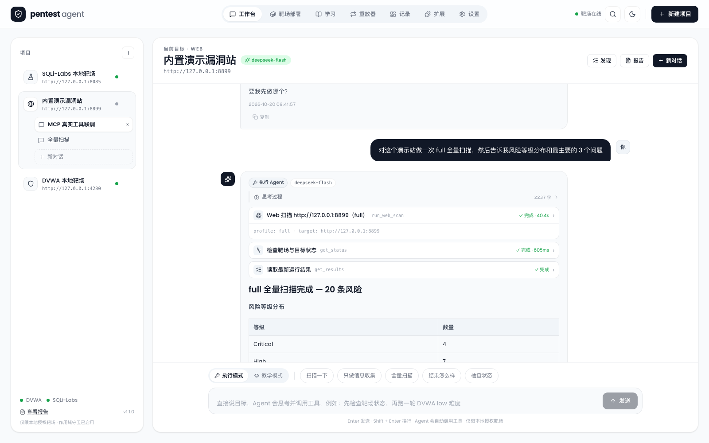

**扫描执行中**：

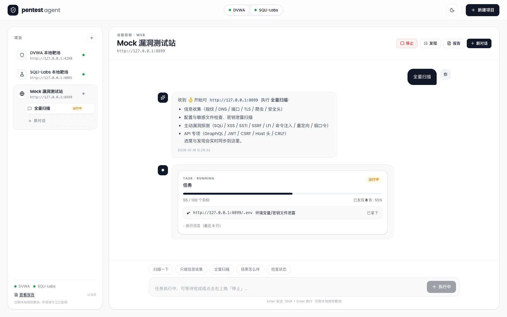

**扫描完成（风险统计 + 攻击面摘要）**：

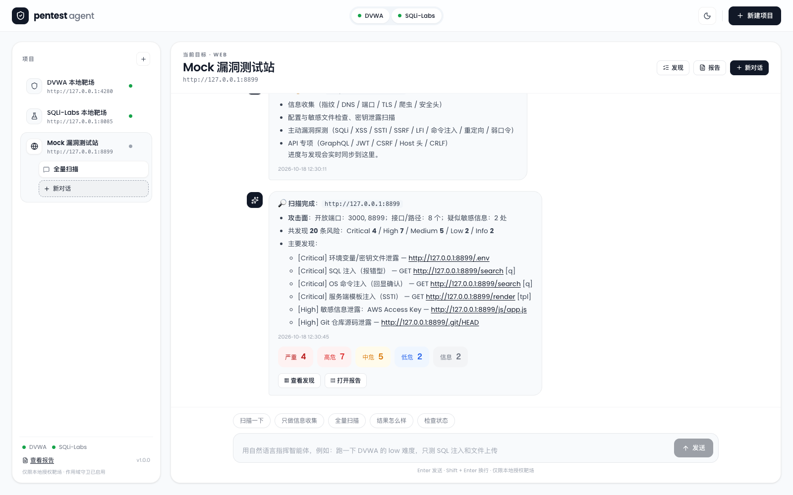

**按风险等级分组的发现（顶部展示攻击面：开放端口 / 接口 / 敏感信息）**：

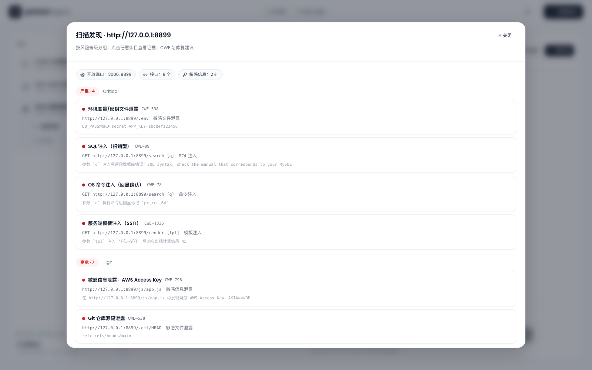

**单条漏洞证据（payload / 请求 / CWE / 修复建议）**：

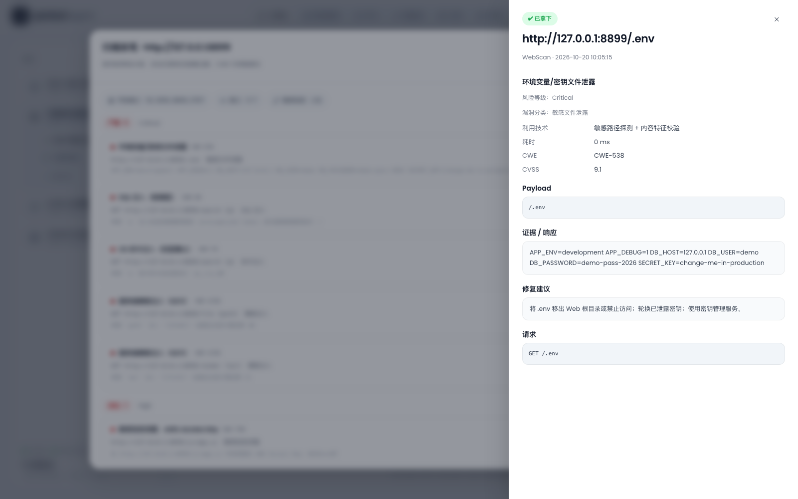

**HTML 可视化报告（可直接预览/下载）**：


### 7.3 安全边界（重要）

- **授权**：默认仅允许 localhost / 内网地址；外部目标必须显式 `--allow-remote`（或项目里开启 `allow_remote`），且需你事先获得**书面授权**；
- **非破坏性**：只做读取/时间差异/回显标记检测，不写文件、不删数据、不反弹 shell；命令注入使用 shell 算术标记避免「反射页面」误报；默认口令最多尝试 3 次，不做大规模爆破；
- **限速与范围**：默认 0.08s/请求，端口扫描仅常见端口，避免影响目标可用性；
- **人工复核**：自动化发现可能存在误报，结果不能替代专业人工渗透测试；
- **当前不包含**：认证后深度测试、反序列化/文件上传利用、CVE 指纹匹配、大规模口令爆破、DDoS/压测、后渗透（提权/横向/反弹 shell）。这些属于高风险或破坏性操作，不在本工具自动化范围内。
- **基础设施检查只读**：Redis 只发送 `INFO`、Memcached 只发送 `stats`、Docker 只请求 `/version`，不写入、不修改任何服务状态；FTP 匿名登录仅验证认证配置。

## 8. 技术架构

```
┌────────────────────────────────────────────────────────────────────────┐
│   接入层：CLI (argparse)                         Web 对话式工作台       │
│   labs / solve / verify / recon       React + TypeScript（左项目/右对话）│
│                                        Flask REST API + SSE 实时事件    │
│                                        前端构建产物由 Flask 托管         │
│                          ┌──────────────────────────────────────┐      │
│                          │  ChatAgent（web/agent.py）            │      │
│                          │  自然语言意图 → 工具编排（扫描/靶场/报告）│   │
│                          └──────────────────────────────────────┘      │
└───────────────┬──────────────────────────────────────┬─────────────────┘
                │                              │
     ┌──────────▼──────────┐        ┌──────────▼──────────┐
     │   LabManager        │        │  Target Detector    │
     │ Docker/compose 管理 │        │ DVWA / SQLi-Labs 指纹│
     │ 镜像构建、DB 初始化 │        └──────────┬──────────┘
     └──────────┬──────────┘                   │
                │                    ┌─────────▼──────────┐
                │                    │  DvwaTarget         │
                │                    │  19 模块 × 4 难度   │
                │                    ├────────────────────┤
                │                    │  SqliLabsTarget     │
                │                    │  69 关卡 + SQL 引擎 │
                │                    └─────────┬──────────┘
                │                              │
     ┌──────────▼──────────────────────────────▼──────────┐
     │                Core 基础设施                        │
     │ HttpClient（会话/CSRF/证据/限速/重试）              │
     │ Scope Guard（作用域守卫）                           │
     │ Models（Finding / LabRun / Status）                 │
     │ Reporter（Rich 控制台 + Markdown + JSON）           │
     │ RunManager（后台任务 / SSE 事件 / 历史持久化）      │
     └────────────────────────────────────────────────────┘
```

关键设计：

- **证据驱动**：每个 `Finding` 保存 payload、请求、响应片段、耗时，报告可直接作为渗透测试记录。
- **状态隔离**：`labs init` / 每个破坏性模块测试前后自动重置数据库（CSRF、CAPTCHA、存储型 XSS 等会修改数据的模块）。
- **难度切换**：DVWA 的安全等级只存在 `security` Cookie 中，Agent 直接操作 Cookie，无需模拟 UI 点击。
- **智能重试**：网络抖动自动重试；模块内部对多 payload 依次尝试；单关异常被捕获并记录，不影响其他关卡。

## 9. 解题原理（核心实现）

### 9.1 DVWA

| 模块 | 关键实现 |
|---|---|
| 暴力破解 | 字典爆破 + low 级别 SQL 注入登录绕过（`username=admin'#`） |
| 命令注入 | 依次尝试 `;`、`\|`、`$(...)`、反引号，检测 `uid=` 回显 |
| 文件包含 | LFI 读 `hackable/flags/fi.php`；medium 用 `....//` 折叠或 `file://`；high 用 `file://` 协议 |
| 文件上传 | low 直传 PHP webshell；medium 伪造 `Content-Type: image/jpeg`；high 构造「合法 JPEG + 追加 PHP」图片马，再通过 FI 包含执行 |
| SQL 注入 | low GET / medium POST / high 会话两步注入，UNION 提取 `users` 表用户名与 MD5 |
| SQL 盲注 | 布尔盲注 + `ASCII(SUBSTRING(...))` 数字比较（规避 medium 的引号转义），逐字符还原 admin 哈希 |
| CSRF | low 无 token / medium 伪造 Referer / high 先取一次性 token；改密后用 `test_credentials.php` 验证副作用 |
| 不安全验证码 | low `step=2` 跳步；medium `passed_captcha=true`；high 伪造 `g-recaptcha-response=hidd3n_valu3` + `User-Agent: reCAPTCHA`；通过改密副作用验证 |
| 弱会话 ID | 分析 `Set-Cookie: dvwaSession`：自增数字 / 时间戳 / `md5(int)` / 40 位随机+Secure+HttpOnly |
| XSS（DOM/反射/存储） | 检查反射/持久化与编码差异；DOM 型验证 sink 与过滤器绕过（`<script` 过滤 → `img onerror`；白名单 → URL fragment）；**无头浏览器实际捕获 alert 作为最终证据** |
| CSP 绕过 | 按级别构造：低=同源 JSONP callback；中=静态 nonce 内联；高=`'self'` 同源 JSONP；无头浏览器提交表单验证执行；impossible 实测存在同源 JSONP 残余绕过 |
| JavaScript 攻击 | 复算客户端 token：`md5(str_rot13())`、字符串反转、双层 sha256 |
| 开放重定向 | low 任意 URL；medium 协议相对 `//host`；high 构造含 `info.php` 的 URL |
| 越权访问 | 普通用户 `gordonb` 直接调用 `get_user_data.php` / `change_user_details.php`，检测 JSON 结果 |
| 访问控制缺陷 | low 伪造 `user_id` Cookie；medium 猜中 `token=user_token`；high/impossible 验证服务端 Session 校验拒绝 |
| 密码学攻击 | low 恒等口令；medium AES-ECB 密文块拼接；high CBC IV 字节翻转（`userid:2`→`userid:1`）；impossible 验证 AES-GCM 防篡改（返回 526） |
| API 安全 | v1 接口泄露口令哈希；PUT 批量赋值提权；health 接口命令注入（写文件 PoC）；OAuth2 流程鉴权校验（401 vs 200） |
| impossible 检测 | 逐模块识别 `is_numeric`/PDO 预处理/白名单/`htmlspecialchars`/token/随机数等防御并判定 PROTECTED |

### 9.2 SQLi-Labs

- **题目建模**：每关抽象为「请求模板 + 注入点 + 注入类型 + 成功证明」，在 `pentest_agent/labs/sqli_labs.py` 中逐关实现/复用攻击函数；
- **注入技术引擎**：UNION 列数探测与回显提取、报错注入（`updatexml`/`extractvalue`/`floor(rand)`）、布尔注入与时间盲注（二分加速，约 7 请求/字符）、堆叠查询、ORDER BY 注入、WAF/空格/关键字/宽字节/注释过滤 tamper；
- **多步骤编排**：Less-11~16 先 POST 登录表单、Less-18/19 先成功登录再注入 Header、Less-20~22 先登录拿 Cookie、Less-24 完整二次注入链（注册恶意用户名 → 登录 → 改密劫持 admin）、Less-54~65 随机表名/列名/key 的提取与提交；
- **状态管理**：每次 `solve()` 开始先调用 `setup-db.php` 重置 `security/challenges` 库；堆叠注入/二次注入使用新的 id/用户名，避免污染后续关卡；
- **挑战关卡**：Less-54~65 共享同一张随机表与 secret key，按各关通道提取（54~57 UNION、58~61 报错、62~65 布尔盲注）后统一提交，成功标记 `images/Less-54-1.jpg`；`/sql-connections/test.php` 泄露的 key 仅作兜底。

> 详细逐关解题笔记见 [`notes/sqli-labs-solutions.md`](notes/sqli-labs-solutions.md)，DVWA 逐模块源码级分析见 [`notes/dvwa-source-analysis.md`](notes/dvwa-source-analysis.md)。

## 10. 目录结构

```
python项目课/
├── pentest_agent/                 # Agent 主包
│   ├── cli.py                     # 命令行入口（labs/solve/verify/recon）
│   ├── core/
│   │   ├── http.py                # HttpClient：会话、CSRF、证据、限速、重试
│   │   ├── models.py              # Finding / LabRun / Status 数据模型
│   │   ├── scope.py               # 作用域守卫（默认仅本地/内网）
│   │   ├── reporter.py            # Rich 控制台 + Markdown + HTML + JSON 报告
│   │   └── labmanager.py          # Docker 靶场生命周期管理
│   ├── mcp_server.py              # 内置安全工具 MCP Server（真实 DNS/HTTP/端口/TLS/hash/JWT）
│   ├── web/                       # Web 平台后端
│   │   ├── server.py              # Flask 路由 + SSE 实时事件流 + 平台 API
│   │   ├── runs.py                # 扫描/靶场任务、事件队列、历史持久化
│   │   ├── security_db.py         # SQLite：资产台账 / 漏洞生命周期 / 扫描历史
│   │   ├── policies.py            # 内置扫描策略（6 种）
│   │   ├── chat.py                # 项目/会话/消息存储（含认证头/策略配置）
│   │   ├── llm_agent.py           # LLM Agent 循环：流式思考 + function calling + 多步工具
│   │   ├── extensions.py          # 扩展系统：技能安装管理 + MCP stdio/HTTP 客户端
│   │   └── agent.py               # 对话式 Agent 工具层：工具实现（静默模式供 LLM 调用）
│   ├── labs/
│   │   ├── dvwa.py                # DVWA 19 模块 × 4 难度解题器
│   │   ├── sqli_labs.py           # SQLi-Labs 69 关解题器
│   │   └── demo_webapp.py         # 内置演示靶场（真实漏洞实现，非 mock）
│   ├── engines/
│   │   ├── webscan.py             # 扫描编排：模块调度、爬虫、攻击面聚合
│   │   ├── webinject.py           # 主动漏洞（SQLi/XSS/SSTI/SSRF/LFI/RCE/重定向/弱口令）
│   │   ├── webapi.py              # API 专项（GraphQL/JWT/CSRF/Host 头/CRLF）
│   │   ├── recon_extra.py         # 资产测绘（DNS/子域/子域接管）
│   │   ├── infra.py              # 端口服务指纹/未授权访问/TLS 深度检查
│   │   ├── secrets.py             # 密钥与敏感信息扫描（脱敏输出）
│   │   └── browser.py             # Playwright 无头浏览器验证（DOM XSS/CSP）
│   └── knowledge/                 # 可扩展的题库/配置数据
├── web/                           # TypeScript 前端（React + Vite）
│   ├── src/components/chat/       # 对话工作台组件（Sidebar/ChatView/MessageItem/ToolCallCard/...）
│   ├── src/components/views/ExtensionsView.tsx  # 扩展页：技能 / MCP 管理
│   ├── src/agent-ui.css           # Agent 对话样式（思考折叠/工具卡/计划清单/流式光标）
│   ├── src/extensions.css         # 扩展页样式
│   ├── src/components/views/      # 平台工作区：态势/资产/漏洞/扫描/设置
│   ├── src/                       # API 客户端、类型、样式
│   ├── dist/                      # 构建产物（已附带，可直接使用）
│   └── package.json
├── skills/                        # 内置技能（SKILL.md 技能包：侦察 / SQLi / 报告）
├── labs/
│   ├── docker-compose.yml         # DVWA + MariaDB + SQLi-Labs 编排
│   └── docker/DVWA.Dockerfile     # DVWA 镜像构建（国内源加速）
├── reference/                     # 靶场源码（自动 clone，可复现构建）
├── reports/                       # 自动生成的报告（Markdown/HTML/JSON）
├── notes/                         # 源码级解题分析（DVWA / SQLi-Labs）+ 逐关状态
├── docs/screenshots/              # Web 工作台界面截图
├── web_runs/                      # Web 任务历史（运行时生成）
├── web_data/                      # 项目/会话（chat.json）与资产/漏洞台账（security.db）
├── scripts/
│   ├── start.sh                   # 一键启动平台（可选拉起靶场/演示目标）
│   ├── verify_all.sh              # 一键验收脚本（启动靶场 + 验证 + 报告）
│   ├── demo_target.py             # 启动内置演示靶场（真实漏洞，等价于 python -m pentest_agent demo）
│   └── demo_mcp_server.py         # 启动内置安全工具 MCP Server（兼容旧路径）
├── tests/                         # 单元测试 + live 集成测试 + Web API/进阶扫描测试
├── requirements.txt
└── README.md
```

## 11. 自动化验证与报告

```bash
python -m pentest_agent verify
```

控制台输出示例（节选）：

```
                    渗透测试结果总览
┏━━━━━━━━━━┳━━━━━━━━━━━━━━━━━━━━━━┳━━━━━━┳━━━━━━━━┳━━━━━━━━━━━━━┳━━━━━━┳━━━━━━━━┳━━━━━━━━━━┓
┃ 靶场     ┃ 目标                 ┃ 关卡数 ┃ 已拿下 ┃ 已防御(预期) ┃ 失败 ┃ 覆盖率 ┃ 完全通关 ┃
┡━━━━━━━━━━╇━━━━━━━━━━━━━━━━━━━━━━╇━━━━━━╇━━━━━━━━╇━━━━━━━━━━━━━╇━━━━━━╇━━━━━━━━╇━━━━━━━━━━┩
│ DVWA     │ http://127.0.0.1:4280 │   76 │     57 │          19 │    0 │ 100.0% │   是     │
│ SQLi-Labs│ http://127.0.0.1:8085 │   69 │     69 │           0 │    0 │ 100.0% │   是     │
└──────────┴──────────────────────┴──────┴────────┴─────────────┴──────┴────────┴──────────┘
```

报告包含：总体统计、逐模块/逐关卡矩阵、每关的 `payload / 技术 / 证据 / 耗时`，以及复现命令。

### 11.1 实测验证结果（本机 macOS arm64 / Docker Desktop）

| 项目 | 结果 |
|---|---|
| DVWA | **76/76 关全部达成预期**：57 关成功利用、19 关 impossible 防御被正确识别（其中 CSP impossible 被无头浏览器实测证伪，属真实残余绕过） |
| SQLi-Labs | **69/69 关全部 EXPLOITED**，0 失败；单次全量运行约 **17 秒 / 842 次请求** |
| DVWA 单次全量耗时 | 约 2 分钟（含 CAPTCHA high 的 reCAPTCHA 外部依赖超时等待与多次数据库重置） |
| `verify` 全量耗时 | 实测 **1.5–2.5 分钟**（DVWA + SQLi-Labs，含浏览器验证；冷/热缓存不同） |
| 浏览器验证 | Playwright + 本机 Chrome 无头模式，实际捕获 `alert` 弹窗；未安装时自动降级为 HTTP 层证据 |
| 报告产物 | `reports/pentest_report.md`（人读）、`reports/pentest_results.json`（机读） |
| 单元测试 | `python -m pytest tests/ -q`，**145 passed / 3 live deselected**（核心模型、SQLi 目录、Web API、通用扫描、进阶扫描、平台数据、AI 教学模式、LLM Agent 循环、技能 / MCP 扩展系统、**真实演示靶场 / MCP 工具**等 148 个用例） |
| 集成验收 | `python -m pytest tests/test_live.py -m live -v`（需靶场运行，跑完整 76+69 关，实测 3 passed / 2m23s） |
| Web 对话工作台 | 左侧项目/会话 + 右侧对话、自然语言指令、实时任务卡片、矩阵证据、报告预览均实测通过（Playwright 截图验证），见 `docs/screenshots/` |
| 扩展系统（技能 / MCP） | 技能：ZIP 上传（含路径穿越拦截）/ 本地目录安装 / 启停 / 预览实测通过，内置 3 个技能；MCP：内置安全工具 Server（7 个真实工具）与本地 HTTP MCP 均连接成功，真实 DeepSeek 对话中成功调用 `list_skills` / `use_skill` / MCP 工具 |
| Agent 对话（Codex 式） | 真实 DeepSeek API 实测：流式思考 + function calling 依次调用 `update_plan` → `get_status` → `run_dvwa` → `get_results`，约 3s 完成「检查状态 → 跑 DVWA low 的 SQL 注入 → 总结」多步任务；停止 / 取消 / 教学模式分层提示均验证通过 |
| 内置演示靶场（真实性） | 真实漏洞实测：SQLi 触发 SQLite 报错并查出真实用户、命令注入由 shell 计算回显标记、LFI 真实读取 `/etc/passwd`、SSTI 真实求值 `{{6*7}}=42`、SSRF 触发本地 canary、JWT alg=none 伪造 admin 成功；全量扫描稳定 **20 条风险（严重 4/高危 7/中危 5/低危 2/信息 2）** |
| 通用 Web 渗透 | 对内置演示靶场实测发现 **20 条风险（严重 4/高危 7/中危 5/低危 2/信息 2）**：SQLi/SSTI/SSRF/命令注入/LFI/XSS/敏感文件/JS 密钥/JWT alg=none/GraphQL/CSRF/Host 头等 |
| 平台数据闭环 | 扫描后自动写入 SQLite：实测 20 条漏洞、12 项资产、扫描历史 1 条；仪表盘统计、漏洞状态流转、资产筛选均在浏览器中验证通过 |
| 验证时间 | 2026-10-20（Agent 对话 / 扩展 / 真实演示靶场与 MCP）/ 2026-10-18（DVWA 与 SQLi-Labs），macOS 27.0.1 (Apple M4) + Docker Desktop 29.6.2 |

**验收命令（从零开始）**：

```bash
# 1) 启动靶场（首次自动构建/拉取镜像并初始化数据库）
python -m pentest_agent labs up

# 2) 全量自动验证并生成报告
python -m pentest_agent verify

# 3) 查看报告
open reports/pentest_report.md        # macOS
```

**关于 mock 与测试替身**：项目运行时不再包含模拟实现——内置演示靶场（`pentest_agent/labs/demo_webapp.py`）与 MCP Server（`pentest_agent/mcp_server.py`）的首版分别是「按 payload 返回固定文本的 mock 应用」和「echo/add 演示工具」，现已全部替换为真实实现。目前仅在**自动化测试**中保留测试替身：`tests/mock_llm.py`（离线模拟 OpenAI 兼容流式接口）、`tests/test_extensions.py` 里的本地 MCP mock server，用于在不联网、不依赖外部服务的情况下做确定性回归测试；它们不参与产品运行。

**已知环境限制**：SQLi-Labs 的 `Less-7`（INTO OUTFILE）在该镜像中 MySQL 对 `/var/www/html` 无写权限，解题器改为写 `/tmp/<随机名>.php`，并用 `LOAD_FILE` 布尔 oracle + UNION 读回文件内容证明任意文件写入能力（证据与说明见报告与 `notes/sqli_solver_status.md`）。

## 12. 常见问题

**Q1：`labs up` 卡在拉取镜像？**
脚本会自动尝试 `docker.1ms.run`、`docker.1panel.live`、`docker.m.daocloud.io` 等国内镜像源。若全部失败，可先手动 `docker pull` 再执行 `labs up`（脚本会复用本地镜像）。

**Q2：DVWA 镜像构建 apt 很慢 / 失败？**
`labs/docker/DVWA.Dockerfile` 默认使用阿里云 Debian 源；可换源：

```bash
docker build -f labs/docker/DVWA.Dockerfile -t pentest-agent/dvwa:local \
  --build-arg APT_MIRROR=mirrors.tuna.tsinghua.edu.cn reference/dvwa
```

**Q3：端口 4280/8085 被占用？**
修改 `labs/docker-compose.yml` 中的 `ports` 映射，并给 `labs up` / `solve` 传入对应地址（`--target` / `--dvwa-url` / `--sqli-url`）。

**Q4：DVWA 的 Insecure CAPTCHA 模块没有 reCAPTCHA Key？**
默认配置下 reCAPTCHA Key 为空，页面会提示 “Please register for a key”。Agent 通过**密码是否真正被修改**的副作用来验证绕过是否成功（`csrf/test_credentials.php`），不依赖页面提示，因此不受影响。

**Q5：为什么 impossible 难度显示 🛡 而不是 ✔？**
impossible 是 DVWA 的「安全代码」难度，设计上就不可利用。Agent 的目标是**识别防御是否生效**：检测到防御（如 PDO 预处理、`htmlspecialchars`、token 校验、随机 Session 等）即判定通过。这才是完整"做出来"的标准。

**Q：内置演示靶场（`python -m pentest_agent demo`）和以前的 Mock 有什么区别？**
旧的 `tests/mock_vuln_app.py` 会按 payload 关键字返回固定文本（例如看到 `echo px_rce` 就返回计算好的结果），本质是「模拟漏洞」。现在演示靶场位于 `pentest_agent/labs/demo_webapp.py`，使用真实 SQLite 数据库、真实 `subprocess(shell=True)`、真实文件读取、真实模板 `eval`、真实 HTTP 出站请求与真实 JWT 解析；扫描器读到的 SQL 报错、命令回显、`/etc/passwd` 内容、SSTI 计算结果都是真实执行产生的。也正因为包含真实的命令执行 / 任意文件读取 / 模板求值漏洞，它只监听 `127.0.0.1`，**绝不能部署到公网**；生产环境请改用 DVWA / SQLi-Labs / Juice Shop 等隔离靶场。

**Q6：浏览器验证报错 / 没有 Chrome？**
```bash
pip install playwright                 # 仅安装驱动，不下载浏览器
python -m playwright install chrome     # 如本机没有 Chrome，可让 Playwright 安装
# 强制关闭浏览器验证（只用 HTTP 证据）
python -m pentest_agent solve --target http://127.0.0.1:4280 --no-browser
```
Agent 会自动检测 playwright 与 Chrome，缺失时静默降级，不影响主流程。

**Q7：Web 界面打不开 / 端口被占用？**

```bash
python -m pentest_agent web --port 9000 --no-browser   # 换端口
lsof -nP -iTCP:8777 -sTCP:LISTEN                        # 查看占用进程
```

前端页面 503 或提示未构建时，执行 `cd web && npm install && npm run build`（仓库已附带构建产物，通常无需重建）。Web 服务默认只监听 `127.0.0.1`，作用域守卫仍然生效。

**Q8：通用扫描能扫公网/客户系统吗？**
默认不能——作用域守卫只允许 localhost / 内网地址。扫描外部目标必须显式加 `--allow-remote`（Web 界面在项目里开启 allow_remote），并确保你拥有**书面授权**。扫描器只做非破坏性检测，但仍可能触发 WAF 告警，请提前沟通。

**Q9：扫描结果准吗？会误报吗？**
发现均附带 payload、请求/响应证据与内容特征校验（例如敏感文件要求特定文件内容、命令注入使用 shell 算术标记避免反射误报），但仍可能存在误报/漏报，需要人工复核。认证后页面、复杂业务逻辑、前端框架路由等场景覆盖有限。

**Q10：SQLi-Labs 的 Less-7（INTO OUTFILE）依赖写入权限？**
Agent 会先通过 `phpinfo` / 布尔 oracle 探测 docroot，再尝试写入；若镜像不允许写文件会给出失败证据（不影响其他关卡）。

## 13. 二次开发指南

**新增 DVWA 模块**：在 `pentest_agent/labs/dvwa.py` 中实现 `solve_xxx(self, level) -> Finding`，并注册到 `MODULES` 列表与 `solve()` 的 `solver_map`。

**新增 SQLi-Labs 关卡**：在 `pentest_agent/labs/sqli_labs.py` 的关卡表中增加条目（URL、方法、注入点、成功判定），复用通用注入引擎。

**接入自己的靶场/CTF**：继承 `HttpClient` 编写目标类；或者直接调用底层引擎：

```python
from pentest_agent.core.http import HttpClient
from pentest_agent.core.scope import assert_in_scope

assert_in_scope("http://127.0.0.1:8080")     # 作用域守卫
client = HttpClient("http://127.0.0.1:8080", delay=0.1)
# ... 自定义测试逻辑，记录 client.history 作为证据
```

**扩展报告格式**：修改 `pentest_agent/core/reporter.py` 的 `build_markdown()` / `save_reports()`。

**扩展 Web 界面**：后端在 `pentest_agent/web/server.py` 增加 API，前端在 `web/src/components/chat/` 增加组件并 `cd web && npm run build` 重新构建；求解器实时进度通过 `solve(..., on_progress=...)` 回调接入。

**扩展 MCP 工具**：在 `pentest_agent/mcp_server.py` 的 `TOOLS` 中新增一条 `{name, description, inputSchema}` 与对应 handler 函数（建议复用 `pentest_agent.core.scope` 的作用域守卫），即可通过内置安全工具 Server 暴露给 Claude / Codex / 本平台等任意 MCP 客户端；也可以在 `extensions.py` 中接入第三方 MCP Server（stdio / Streamable HTTP），无需改前端。

**扩展演示靶场漏洞**：在 `pentest_agent/labs/demo_webapp.py` 的 `do_GET` / `do_POST` 中新增真实漏洞端点（并同步 `tests/test_demo_webapp.py` 的真实性断言），即可让演示靶场覆盖更多漏洞类型；注意保持「仅回环监听 + 明确风险提示」。

**扩展对话 Agent**：在 `pentest_agent/web/llm_agent.py` 的 `_build_agent_tools()` 里新增一个 `ToolSpec`（JSON Schema + handler）即可让大模型自主调用新工具；handler 建议复用 `ChatAgent` 的工具方法（加 `quiet=True` 时只返回结构化结果、不刷屏消息）。规则引擎路径仍可在 `agent.py` 的 `_plan()` / `_dispatch()` 中扩展，作为未配置模型时的兜底；所有工具调用都复用 `run_manager` / `store`，无需改前端渲染。

**接入自己的前端**：所有能力都通过 `/api` REST + SSE 暴露，可使用任意语言/框架重写界面。

## 14. 免责声明

本项目仅用于**本地授权靶场**的安全学习、教学演示与防御验证。工具内置作用域守卫，默认拒绝非本地目标；`--allow-remote` 仅应用于你**已获得书面授权**的系统。任何未经授权对他人系统进行渗透测试的行为均可能违法，使用者需自行承担全部法律责任。
